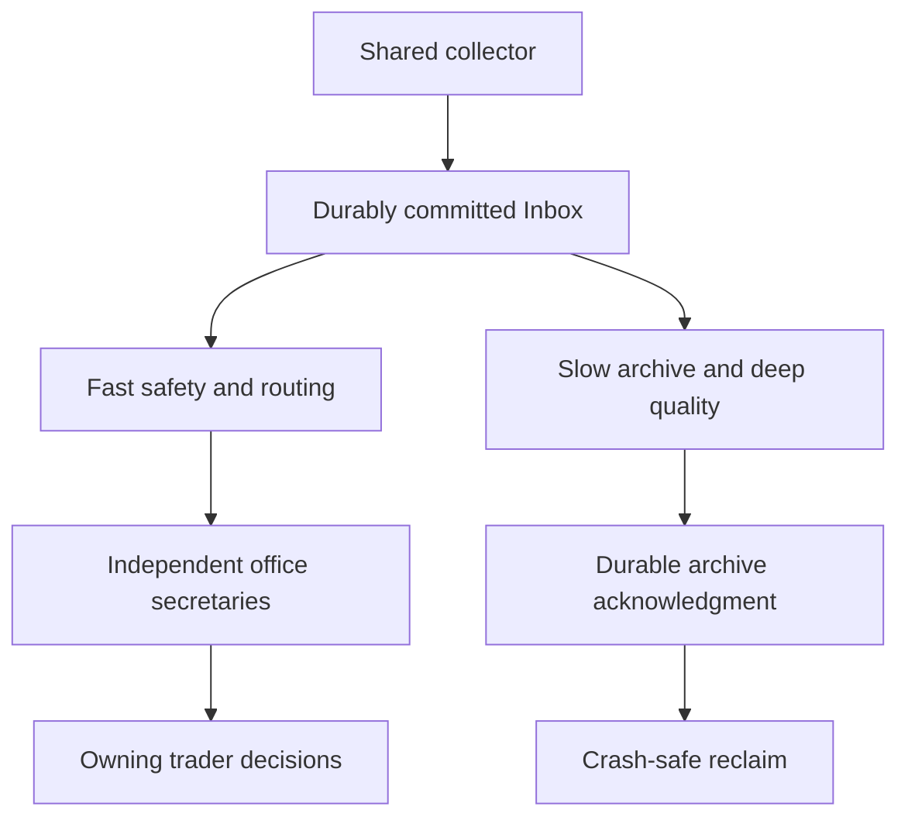

# Initial schema contracts — conceptual
UniverseSnapshot: scan_id, symbol, discovered_at, as_of, eligibility_status [ELIGIBLE, UNSUPPORTED, DATA_ERROR], reason, source_version.
MarketBar: symbol, interval, bar_open, bar_close, OHLCV, is_final, ingested_at, source; closed-bar eligibility requires bar_close<=decision_cutoff plus receipt/availability evidence; provisional TIME-01 permits a separate intra-candle/live observation only with verifiable exact availability by decision time, fallback to qualifying completed candles only when explicitly allowed by the trader's predeclared policy and availability/freshness checks; otherwise block the affected decision with a reason. Never treat a later finalized OHLCV as an earlier intra-candle snapshot.
FeatureSnapshot: symbol, as_of, data_cutoff, feature_set_version, values, missing_flags, input_digest.
Observation: observation_id, symbol, decision_at, reference_price/source, feature_snapshot_ref, regime_ref, reasons; immutable.
Outcome: observation_id, horizon [4h,24h,72h], due_at, max_return, min_return, time_to_target, order_resolution [KNOWN, AMBIGUOUS, MISSING], maturity [PENDING, COMPLETE, MISSING].
ExternalEvent: event_id, type, source, event_time, published_at, observed_at, affected_assets, provenance, license, correction_ref.
Trader/Signal/Trade: trader_id, immutable strategy_version, signal_id, state transitions with timestamps, conditional entry, invalidation, expiry, fill_model_version, paper fills, costs, net return and R.
Experiment: hypothesis_id, frozen parent/shadow, primary metric, trial count, selection/test windows, results, owner decision.
Keep forward outcomes separate from decision snapshots. UTC timestamps, schema version and idempotency key throughout.

## Proposed paper/research state requirements — no implementation

**Status: PROVISIONALLY OWNER-APPROVED — NOT FINAL G0 APPROVAL.**
References: [G0-PAPER-01–08](03_DECISIONS.md#g0-paper-trading-decisions--owner-selected-provisional-rules). The following are conceptual record/event requirements, not SQL tables, migrations or finalized new enum contracts. Existing state/order_resolution/maturity enums above are preserved; future enum mapping requires interface review.

- Opportunity/entry context: trader_id, strategy_version, signal_id, opportunity identity/dedup policy version, symbol, signal availability time, entry conditions, first eligible observable price/time/source, validity window, early-invalidation rule/version, expires_at and terminal reason. Distinguish NO_FILL, expiration, rejection and data errors without conflating signal lifecycle with accounting outcomes.
- Frozen trade policy: trade identity, reference_notional/currency (provisional 1,000 USDT), entry/fill/exit policy snapshots and versions, event-time lifecycle history, permitted rule-driven adjustments with timestamp/reason, fill/exit modeled price and source, exit reason independent of price/cost.
- Execution estimate: gross return, baseline net, independent stress-cost scenario, fee source/tier/maker-taker/discount/promotion assumptions and effective date, spread/slippage/liquidity evidence, notional sensitivity and unavailable-data flags. No immutable example fee percentage.
- Outcome uncertainty: factual order_resolution AMBIGUOUS remains distinct from hypothetical worst/best scenario resolution and stress costs; preserve finer-data provenance and visibility. Trader aggregate reports include best/worst performance, assumptions, confirmed/ambiguous/unresolved denominators and correlation grouping. Never count scenario bounds as verified outcomes.
- Lab/counterfactual: original signal/trade reference, independent variant/path identity, frozen initial conditions and policy versions, preregistered research horizon, observations after original exit, original-target touches/times, TP1 activation/stop-adjustment/stop-hit/TP2 chronology and protected-downside/missed-upside metrics. Keep counterfactual records separate; do not reopen/mutate the original closed trade.
- Recovery/event progress: durable pending/open state plus policy snapshots, event identity/idempotency key, processing checkpoint, market event time, observed/ingested time and recovered_at, source interval/gap coverage, unresolved reason (e.g. UNRESOLVED_DATA_GAP), accounting correction lineage and audit evidence. Replay must not duplicate execution, accounting or alert records.
- Restored historical facts may label outcomes/correct accounting with traceable revisions; decision-time feature visibility and immutable original decisions stay unchanged. Price-based intrabar reconstruction must not manufacture strategy evaluations made while offline.

Exact field types, physical storage, identity keys, retention and policy parameters remain deferred to later reviewed specifications. Existing conceptual event timestamps/IDs and trader independence remain intact.

## Proposed TIME/DATA conceptual requirements
**PROVISIONALLY OWNER-APPROVED — NOT FINAL G0 APPROVAL.**
[Canonical decisions and owner clarifications](03_DECISIONS.md#g0-time-and-data-provisional-decisions). Descriptive requirements only: no physical tables, executable schemas, migrations or finalized field types/enum additions.

### Temporal provenance and immutable context
TIME-01–04/07–09: every usable observation tracks market/event/measurement time, receipt/ingested_at, effective available_at, decision_at, clock-skew/quality, evidence source and version; absence of real receipt evidence is an explicitly conservative modeled-replay assumption. News records original published_at AND added_to_atlas_at, first_verified_observed_at when available, content/version/edit lineage, source/evidence and scheduled-vs-unexpected nature. Imported archives cannot backdate ATLAS ingestion or substitute edited content into past decisions.
Every opportunity including rejected/expired/no-fill/executed references an immutable context snapshot: BTC dominance, multi-timeframe BTC trend, BTC/ETH and ETH/BTC, altseason/breadth, liquidity, volatility, volume/trend strength, asset relative strength/sector/correlation and justified extras where feasible. Per field: provider/local calculation method, source, measurement/event/receipt/availability timestamps, freshness/age/policy, version, missing status, essential/optional use and budget/availability limitations. Shared snapshot IDs avoid duplicate acquisition/blobs. Separate evidence class: demonstrably available at decision, reconstructed under declared historical assumptions, retrospective explanation unavailable to trader. Open-position context changes append separate timestamped observations/events linked to the frozen original snapshot; never replace it. Regime transitions retain detected/available times and detector version/confidence/unknown state.

### Reproducible research and specialist report
TIME-04–08: shared immutable dataset/archive object versions, checksums/provenance, correction cause/diff and affected experiments; distinguish data correction from simulator/code correction. Freeze strategy/code/rules/parameters/configuration, experiment and data versions, nomination time and prospective Forward/Shadow start; retain failures/selection history. Historical development, historical OOS and prospective forward have separate identities/results and side-by-side sections, NO combined historical/forward success score.
For every candidate and forward trader, predeclare target regimes/eligibility and report target plus observed off-target opportunity/trade counts, gross/net-cost results, drawdown/risk, uncertainty/sample adequacy and insufficient-evidence status. Record temporal splits/independent regime occurrences and final holdout access; detector lag/errors are evaluated independently. Divergence investigation records regime-distribution shifts, detector errors, costs, data quality and overfitting hypotheses distinctly from proven causes. Forward eligibility references only demonstrably available inputs; policy variants/counterfactuals stay isolated from original PAPER-07 exits.

### Library coverage and provider inventory
DATA-01–04: coverage scope/version identifies assets, markets, timeframes, date ranges, market indicators, context and news/event archives, provider/local method/rights, missing segments, unsupported sources, quality limitations, backfill progress, validation/integrity status and checksums/correction lineage. Initial backfill phase is separately scheduled pre-operational preparation; completeness_verified is relative to declared scope, never an unconditional archive-complete claim. Incremental append/repair references the SAME library/version inventory after launch.
Archive metadata supports source/symbol/timeframe/period/version/integrity partitions and selective reads/cache/object reuse; format (including candidate Parquet) and physical storage remain deferred. Track retrieval latency, storage footprint, transfer/compute estimates and actual budgets. Every external indicator has freshness and provider-specific request budget/availability limitations, not assumed Binance coverage.

### Isolated scheduling and cost controls
DATA-01/02/04: run identity/class (Core Live, Context, Archive Maintenance, Research), independent schedule/queue, bounded concurrency/ownership/non-overlap controls, resource reservation/equivalent policy and progress/resume/idempotency checkpoint. Shared dedup acquisition plan/cache keys and coordinated provider endpoint-weight usage apply across ALL workers/runs. Background jobs yield before core starvation; no synchronous archive/repair/enrichment/backtest/report dependency in the core path.
Track core duration/deadline misses, backlog, freshness lag, CPU/memory/I/O/DB/network contention and provider budgets. Numeric performance targets are benchmark-derived, not a 30-second guarantee. Missing essential inputs have explicit degraded/unknown/rejected reasons and missed-opportunity evidence; no fabricated prices/fills/offline decisions.
Budget ledger: provider/data, storage, transfer, compute usage/limits/forecasts, proposed chargeable service or upgrade, owner approval evidence before activation and cost-limit/defer state. Zero cost not guaranteed; growing research cannot silently spend. No provider or resource is purchased by this conceptual model.

Pending G0-PAPER IDs are external proposal references in PR #7, not declared merged schemas. Existing enums/IDs are preserved; finalized physical keys, access policies, thresholds and storage choices require later review.

## Proposed governance and live-data records — GOV-01 / DATA-05–08
**PROVISIONALLY OWNER-APPROVED — NOT FINAL G0 APPROVAL.**
Conceptual fields/relationships only, no database tables/migrations/operational constants. [Canonical decisions](03_DECISIONS.md#g0-live-data-operations-decisions--data-0508). Existing enums and base conceptual definitions preserved; physical types/interfaces remain deferred.

- Handoff metadata: unique handoff_id, date, project ID/repository, scope/covered_decision_range, owner-confirmed submitted baseline and confirmation evidence, direct receipt separately, addendum IDs/precedence/source, accessed/unavailable records, audit outcome, resulting PR/head, review/merge status and dated update evidence.
- Delta item: source/baseline/item ID, decision/clarification/correction/requirement/exception/owner-deferral kind, approval status, disposition INCLUDED/ALREADY_DOCUMENTED/OWNER_DEFERRED/UNRESOLVED, exact handoff section or verified file/commit/PR+merge state, gap/requested reference and next action. A draft is not owner-submitted; unknown coverage is not PASS.
- Acquisition/feed: provider/source, symbol, stream/data type, live WebSocket vs REST initialization/recovery classification, event_at/received_at/available_at/processed_at/decision_at and evidence, shared cache key/version, freshness policy/age and provider budget authority. Distinct live observations require exact temporal eligibility; never substitute later finalized bars.
- Health: conceptual HEALTHY/DEGRADED/UNAVAILABLE, state transition at observed/detected time, liveness/provider message/sequence/continuity/reconciliation evidence, per-source/indicator TTL, affected traders/positions/required inputs, uncertainty/reason and residual gaps. Lack of recent trades is not sufficient outage evidence.
- Run/job: core/position-monitor/scanner/context/archive/research identity, priority/deadline, actual start/end/duration/lag/deadline miss, queue depth, non-overlap/concurrency/ownership controls, skipped/coalesced scanner cycle evidence and reason, retained monitoring/fill/ambiguity/replay/audit sequence references. Monitoring must not depend on universe scan completion.
- Recovery: outage window, affected scope/position, reconnection attempts/backoff evidence, REST range/reconciliation source, budget usage, gap/coverage result, chronological event identity/idempotency progress, unresolved order/ambiguity and correction lineage. Positions remain open with explicit monitoring gaps until legitimate policy/outcome evidence supports change.
- Shared workload/budget: WS connection/subscription and REST endpoint-weight usage governed jointly across loops, deduplicated acquisition/cache provenance, resource reservations/equivalents for CPU/memory/I/O/DB/network, background yield actions and lag. No fixed endpoint/TTL/polling/cadence/concurrency or SLA adopted.
- Future read-only dashboard may reference health/run-lag/missingness records consistently with Telegram; no UI/API/schema implementation or live authority. Keep initial historical preparation/incremental maintenance isolated under pending DATA-01–04 and independent trader/exit/recovery semantics under pending PAPER-01–08.

Register policy is in HANDOFF_REGISTER.md; this is only the conceptual data relationship, not a second metadata register.

## Integration evidence requirements — INT-04/05/06
Conceptual documentation only. Every observation reference includes observation class (live trade/price, provisional intrabar indicator, completed candle), candle completion state, source/version, event_at, received_at, available_at and decision_at. The trader's frozen input/fallback policy version and eligibility/block reason accompany decisions; unavailable evidence never implies permission to fall back.
Current-state evidence: status, scope, verified_at with timezone, verification source, PR/branch/commit reference and uncertainty/conflict state. Historical event records preserve observed_at/recorded_at, original statement/source and separate subsequent correction/supersession links. Handoff event identity is not branch identity: one real-world event may have multiple source references without duplicate counting. No physical types, tables or operational constants are selected.

## Conceptual secretarial data lifecycle — G1-ARCH-01–11
Requirements only: no storage engine, table, migration, runtime setting, deployment or final physical type selected. Full owner requirements remain canonical in DECISIONS.

- Inbox receipt/commit: stable source/event identity appropriate to data type, observation/version/payload reference, source/stream/symbol, event_at/received_at/committed_at/available_at, completion/finality/quality/health, integrity/checksum evidence and durable receipt status. Equal prices do not imply duplicate events. Never-received and received-but-uncommitted data remain distinct from successfully committed records.
- Independent consumer progress: Fast delivery progress and Slow archival progress/acknowledgment have independent references; one consumer cannot destroy another's required evidence. Raw durable archive reference plus quality/provenance annotations, acknowledgment evidence and reclaim checkpoint link receipt -> committed -> independently delivered/archived -> confirmed archive acknowledgment -> reclaimable/reused capacity. A crash at each boundary must be recoverable idempotently; no unconditional zero-loss claim.
- Capacity/reception: declared bounded capacity, disk usage/full state, backpressure/overflow-policy reference (unselected), corruption detection, durable checkpoint, alerts and incomplete/uncommitted gap evidence. Pausing deep Slow Lane processing is distinct from reception; finite capacity/failure cannot be concealed as continuous success.
- Delivery/subscription: office_id, owning trader_id/secretary identity, declared scan stage, symbol/stream/fields, required policy/version/freshness, immutable position/exit-rule snapshot references, observation identity, per-office event ordering/delivery_at/available_at/lag/interruption state. Indexed open-position ownership maps to required fields; one observation may serve several traders without merging independent state or delaying other offices behind matching/analysis.
- Quality/eligibility: common source/version/finality/event/receipt/availability/health annotations, office policy/version and essentiality, eligibility/fallback permission and reason. Preserve actual provisional indicator versus completed candle; later deep-review/correction annotations have their own time/version/lineage and never replace original decision-time evidence.
- Resource adaptation: Fast latency, office lag, backlog and CPU/memory/I/O/network/DB/provider-budget pressure, Slow pause/yield/resume evidence and hysteresis-policy reference. No numeric threshold or guarantee chosen.
- Research inputs: separate historical/version/coverage/gap/quality/recovery references and live Forward/Shadow receipt/availability records, interruptions/lag/missingness; development/OOS/forward evidence identities remain separate.
- Gap/recovery ledger: Slow Lane owner, symbol/stream/missing range/source, gap detection evidence, recovery attempts/shared-acquisition authority/budget, recovered coverage/residual gaps/quality, declared-scope completeness check, idempotency/progress and live/recovered provenance. Recoverable candles may not establish exact historical tick/trade order.
- Position recovery: owning trader and frozen recovery/exit policy, recovered factual crossing/gap/uncertainty, distinct current market facts, actual recovery-time availability/decision references, AMBIGUOUS and separate scenario paths. Historical crossing is not fill evidence. Conditional future execution records would require actual exchange orders/trades/fills/partial fills; this is not a current real-execution schema authorization.

Fast delivery follows the necessary commit boundary, not the archive acknowledgment. Position matching is one priority branch of independent office delivery, never a serial gate before all offices. Full capacity/ack/recovery implementation is unselected.
