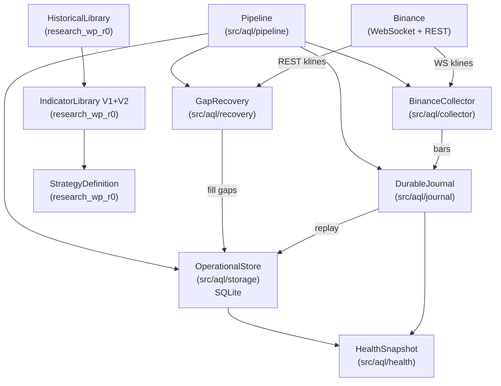

# ATLAS Quant Lab — Master System Map
**Version:** 1.0-DRAFT  
**Date:** 2026-10-24  
**Repository:** scannercrypto0-gif/super-kumo-v8 @ `4e4c353`  
**Status:** DOCUMENTATION ONLY — no implementation authorized beyond what is VERIFIED IN MAIN

---

## 1. Project Identity

| Field | Value |
|-------|-------|
| Project | ATLAS Quant Lab |
| Project ID | AQL-CRYPTO-RESEARCH-001 |
| Phase | G1 MARKET FOUNDATION (implemented, not production-authorized) |
| Architecture | Python Modular Monolith |
| Trading mode | Paper only — no live execution |
| Primary exchange | Binance Spot USDT |

---

## 2. Confirmed Departments (13)

### A. Historical Data Library (Research Lane)
**Status:** L2 Implemented (isolated module)  
**Location:** `research_wp_r0/historical_library.py` (1,154 lines)  
**Responsibilities:**
- Stores and versions OHLCV bar data in a custody-controlled library
- Enforces point-in-time correctness via `decision_cutoff_ms`
- Provides `CustodyAccessor.range_query()` with `require_complete` flag
- Maintains `manifest_integrity_hash` (includes `created_at_ms`) for provenance
- Enforces `require_confirmed_availability=True` — no future-bar leakage
- Supports dataset versioning and immutable historical snapshots

**What is NOT here:** live data ingestion, Supabase storage, large-scale archiving

---

### B. Live Market Data Center (G1 Operational Lane)
**Status:** L2 Implemented (synthetic tests only; live blocked by proxy)  
**Location:** `src/aql/collector/binance_collector.py`, `src/aql/journal/durable_journal.py`  
**Responsibilities:**
- Binance WebSocket (`wss://stream.binance.com:9443`) — public, no API key
- REST `/api/v3/klines` for gap recovery — public, no API key
- Exponential backoff reconnect (MAX_RECONNECT_ATTEMPTS=10)
- Gap window tracking: `gap_start_ms` on disconnect, `gap_end_ms` on reconnect
- Durable journal (SQLite WAL) as crash-safe inbox before store write
- Idempotent upsert via `UNIQUE(symbol, interval, bar_open)`

**What is NOT here:** Supabase integration (deferred, NOT_TESTED), rate-limit live validation, multi-symbol production scale

---

### C. Strategy Factory (Research Lane)
**Status:** L2 Implemented (core contracts), L1 Architecture (pipeline)  
**Location:** `research_wp_r0/` — `historical_library.py`, `indicator_library.py`, `indicator_library_v2.py`, `strategy_definition.py`  
**Responsibilities:**
- SF-DATA-01: `CustodyAccessor` / `HistoricalLibrary` — versioned PIT-safe bar data
- SF-IND-01: `IndicatorLibrary` — SMA, EMA, RSI, ATR with provenance hashes
- SF-IND-02: `indicator_library_v2.py` — additive V2 registry (6 OHLCV indicators), `VectorResult`
- SF-STRAT-01: `strategy_definition.py` — immutable declarative research contracts, `StrategyDefinition` JSON validation, canonical serialization, SHA-256 digests
- Dependency guard (`_dep_guard.py`) — enforces no external pip dependencies
- Strategy versioning, parameter freezing, indicator binding

**What is NOT here:** backtesting engine, out-of-sample runner, holdout management, Batch-01 candidates (Issue #46 open PR), strategy promotion logic

---

### D. Strategy Explorer
**Status:** L0 Concept — NOT IMPLEMENTED  
**Evidence:** Referenced in architecture documents only; no code, no Issues, no PRs  
**Proposed responsibilities:** pattern discovery, statistical relationship search, new hypothesis proposals, market condition discovery  
**Assessment:** No separate department exists. This capability is implied by the Research Lab (F) and Strategy Factory (C) combination. Recommend treating as a future sub-function of the Research Lab rather than a standalone department until implementation demand is clear.

---

### E. Asset Intelligence Lab
**Status:** L0 Concept (Issue #72 open, unprioritized)  
**Evidence:** Issue #72 `[FUTURE-RESEARCH] Asset Intelligence Lab — on-demand BTC/PAXG specialist outlooks & cross-engine consumption (unprioritized)`  
**Proposed placement (per Issue #72):** under Strategy Factory  
**Proposed responsibilities:**
- On-demand BTC and PAXG specialist analysis
- Historical and probabilistic outlooks
- `AssetOutlook` results with source, timestamp, and version metadata
- Cross-engine consumption with read-only isolation from live systems

**Key governance questions (from directive):**
1. Standalone vs. Factory sub-lab: UNDECIDED — requires owner decision
2. Prevention of research-to-signal promotion: NOT DESIGNED
3. Resource isolation from live operations: NOT DESIGNED
4. Future asset extensibility: NOT DESIGNED

**Recommendation:** Keep under Strategy Factory as a specialized lab until usage patterns require independence. See `10_OPEN_DECISIONS.md` Decision OD-04.

---

### F. Research Lab
**Status:** L0–L1 Architecture (significant open PR backlog)  
**Evidence:** Issues #17–#46 (Research Work Packages R0–R40), PR #46 open  
**Responsibilities (designed, not implemented):**
- Backtesting with PIT-correct data
- Shadow Testing
- Walk-forward and Out-of-Sample evaluation
- Holdout custody gate (WP-R6, Issue #24)
- Pre-registered trial journal with cryptographic lineage (WP-R7, Issue #25)
- Paired evaluation engine (WP-R2, Issue #20)
- No-fill opportunity accounting (WP-R3, Issue #21)
- Statistical audit with fail-closed inference (Issue #22)

**What is NOT here:** any of WP-R1 through WP-R40 are implemented; 22 open PRs and issues in the research backlog

---

### G. Secretariat Office
**Status:** L1 Architecture (provisional design, G1-ARCH-01–11)  
**Evidence:** `01_CONTRACT.md` sections G1-ARCH-01–11, `03_DECISIONS.md`  
**Designed responsibilities:**
- One logical secretary per independent virtual trader
- Routes market observations from shared Binance acquisition to traders
- Does NOT decide entries or exits — routes and validates only
- Independent Fast Lane and Slow Lane consumption from Durable Inbox
- Priority management: Position Monitor > Scanner > archive/research

**What is NOT here:** code, tests, or implemented Secretariat; all G1-ARCH-01–11 are documentary design only

---

### H. Opportunity Scanner
**Status:** L1 Architecture (provisional design, G1-ARCH-12–20)  
**Evidence:** `01_CONTRACT.md` sections G1-ARCH-12–20, `03_DECISIONS.md`  
**Designed responsibilities:**
- Central Scanner evaluates each trader's versioned preliminary filters
- Routes candidates and maintains independent `(trader, symbol)` stage state
- Progressive evidence delivery: WATCH → BUILDING → READY (or direct WATCH→READY)
- Bounded adaptive batches; yields to Position Monitor under load

**What is NOT here:** code, tests, or any implemented Scanner logic

---

### I. Virtual Traders
**Status:** L1 Architecture (states designed, no trader code)  
**Evidence:** `01_CONTRACT.md`, `02_ROADMAP.md` (G3 Momentum Trader = first trader)  
**Designed responsibilities:**
- Strategy-specific independent decision-makers
- Lifecycle: WATCH → ARMED → TRIGGERED → CLOSED (+ NO_FILL, EXPIRED, CANCELLED)
- Conditional entry/exit, stops, targets, expiry
- Frozen strategy snapshot at trade creation
- Paper fills with fees, slippage, ambiguity tracking
- Multiple traders can hold same symbol independently

**What is NOT here:** any trader code; G3 Momentum Trader is the first planned implementation

---

### J. Market Intelligence
**Status:** L0 Concept — NOT IMPLEMENTED  
**Evidence:** Referenced in contracts and schemas; no code or Issues  
**Proposed responsibilities:**
- BTC trend and dominance
- ETH/BTC ratio
- Liquidity and volatility indicators
- Market breadth and altseason signals
- Economic context and regime detection

**Distinction from Asset Intelligence Lab (E):** Market Intelligence covers broad market-wide signals used as context for all traders; Asset Intelligence Lab produces deep specialist analysis for specific assets (BTC, PAXG) on demand. The boundary requires owner clarification — see `10_OPEN_DECISIONS.md` OD-05.

---

### K. Monitoring & Dashboard
**Status:** L0 Concept — DEFERRED  
**Evidence:** `02_ROADMAP.md` "Future requirement — unified monitoring dashboard"; no code  
**Designed responsibilities:**
- System health, data freshness, operational errors
- Open paper positions and signal lifecycle
- Trader performance and research results
- Telegram notifications
- Read-only with scoped authentication

**Governance:** Explicitly deferred until operational records exist. No UI code authorized.

---

### L. Governance & Orchestration
**Status:** L4 Validated (documentation and process)  
**Evidence:** All `0N_*.md` files, Issues #1–#15, PR merge history, CI workflows  
**Responsibilities:**
- Architecture decisions (G0-ARCH, G1-ARCH-01–44, ADRs in `03_DECISIONS.md`)
- Change control, owner approvals
- Stage gates G0–G6
- Test policy (`10_TEST_POLICY.md`)
- Risk register (`08_RISKS.md`)
- Session continuity and handoff protocols

**Assessment:** Most mature department. Documentation quality is high. Implementation governance ahead of execution.

---

### M. Shared Infrastructure & Storage
**Status:** L2 Implemented (SQLite local), L0 (Supabase, archiving, backup)  
**Evidence:** `src/aql/storage/operational_store.py`, `src/aql/journal/durable_journal.py`  
**Responsibilities:**
- SQLite operational store (WAL mode, idempotent upsert)
- Durable journal as crash-safe inbox (SQLite WAL, checkpointing)
- Recovery bounded weight budget (MAX_SESSION_WEIGHT=1200/6000)
- Supabase: `SUPABASE_STATUS = "NOT_TESTED"` — deferred per G1-PLAN-01/B
- Issues #67 (Supabase capacity decision) and #71 (Phase 1 local archive) open

**What is NOT here:** Supabase live connection, Parquet archiving, backup/restore pipeline (Issue #71), multi-symbol storage

---

## 3. Candidate Additional Departments

### N. Shared Indicator Box (G1-ARCH-21–44)
**Status:** L1 Architecture — documented design, not implemented  
**Recommendation:** Treat as a sub-system of Strategy Factory / Secretariat interface layer, not a standalone department. The design (one central box manager, demand-aware subscriptions, technical validity lifecycle) is well-specified but has zero code.

### O. Events & News Intelligence
**Status:** L0 Concept (G5 in roadmap)  
**Recommendation:** Future standalone department when G5 work begins. References in contracts to macro/Fed, token unlocks, news, social, search — all unimplemented.

---

## 4. Department Summary Table

| # | Department | Code | Tests | Maturity |
|---|-----------|------|-------|---------|
| A | Historical Data Library | ✅ Yes | ✅ Yes | L2 |
| B | Live Market Data Center | ✅ Yes | ✅ Synthetic | L2 |
| C | Strategy Factory | ✅ Yes | ✅ Yes | L2 |
| D | Strategy Explorer | ❌ No | ❌ No | L0 |
| E | Asset Intelligence Lab | ❌ No | ❌ No | L0 |
| F | Research Lab | ❌ No | ❌ No | L0-L1 |
| G | Secretariat Office | ❌ No | ❌ No | L1 |
| H | Opportunity Scanner | ❌ No | ❌ No | L1 |
| I | Virtual Traders | ❌ No | ❌ No | L1 |
| J | Market Intelligence | ❌ No | ❌ No | L0 |
| K | Monitoring & Dashboard | ❌ No | ❌ No | L0 |
| L | Governance & Orchestration | ✅ Docs | ✅ CI | L4 |
| M | Shared Infrastructure | ✅ Partial | ✅ Synthetic | L2 |

---

## 5. Architecture Pattern

**Modular Monolith** — confirmed and intentional per `01_CONTRACT.md`:
> "Modular monolith remains; separate deployed services are not required."

Two independent lanes within the monolith:
- **G1 Operational Lane** (`src/aql/`): Binance → Journal → Store → Recovery → Health
- **Research Lane** (`research_wp_r0/`): Historical Library → Indicators → Strategy Definitions

These lanes share NO code imports and are tested independently. The research lane has zero dependency on `src/aql/`.

