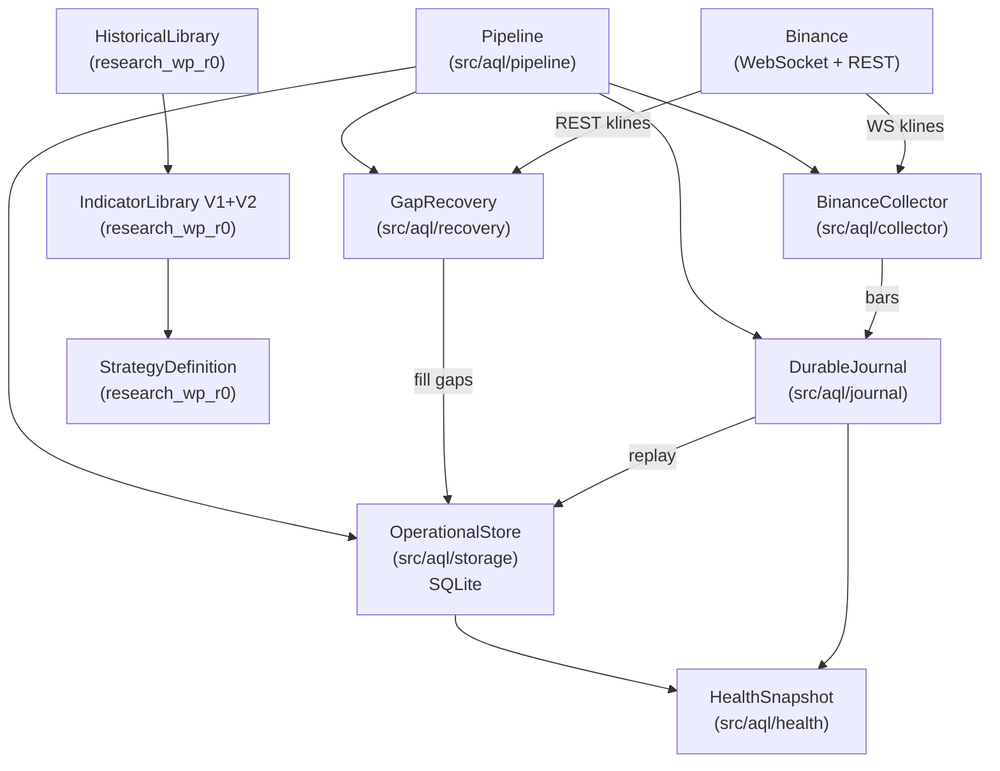

# ATLAS Quant Lab — Master System Map
**Version:** 1.2-CLOSEOUT | **Evidence snapshot:** 2026-10-24
**Main source baseline:** `bcca2238e019b750f564d4b5568e33f2a7aaf5cf` | **Documentation:** PR #74, pre-merge closeout snapshot; ready/merge state is authoritative in GitHub metadata.
Reviewed documentation baseline: `e4ce1c8a5d7911f52fb67e52f7e58c2e0ee5b476`; final document HEAD is in PR metadata/correction matrix, not the main-source SHA.
Evidence IDs and scope: [09_EVIDENCE_REGISTER.md](09_EVIDENCE_REGISTER.md). No production authorization or owner decision is created by this map.

---

## 1. Project Identity

| Field | Value |
|-------|-------|
| Project | ATLAS Quant Lab |
| Project ID | AQL-CRYPTO-RESEARCH-001 |
| Phase | G1 MARKET FOUNDATION (implemented, not production-authorized) |
| Architecture | Python Modular Monolith |
| Trading mode | Paper-only design; no operational paper/live trader authorized by this map |
| Primary exchange | Binance Spot USDT |

---

## 2. Thirteen functional areas (ownership map, not thirteen deployed services)

### A. Historical Data Library (Research Lane)
**Status:** L2 Implemented (isolated module)
**Location:** `research_wp_r0/historical_library.py` (main baseline)
**Responsibilities:**
- Stores and versions OHLCV bar data in a custody-controlled library
- Enforces point-in-time correctness via `decision_cutoff_ms`
- Provides `CustodyAccessor.range_query()` with `require_complete` flag
- Maintains `manifest_integrity_hash` (includes `created_at_ms`) for provenance
- Enforces `require_confirmed_availability=True` — no future-bar leakage
- Supports dataset versioning and immutable historical snapshots

**What is NOT here:** live data ingestion, Supabase storage, large-scale archiving

---

### B. Live Market Data Center (G1 Operational Lane)
**Status:** L3 INTEGRATED — bounded G1 path; #64 reports ACCEPTED WITH FOLLOW-UPS for finite REST/WS/finality/reconnect + harness-scheduled recovery, not production
**Location:** `src/aql/collector/binance_collector.py`, `src/aql/journal/durable_journal.py`
**Responsibilities:**
- Binance WebSocket (`wss://stream.binance.com:9443`) — public, no API key
- REST `/api/v3/klines` for gap recovery — public, no API key
- Exponential backoff reconnect (MAX_RECONNECT_ATTEMPTS=10)
- Gap window tracking: `gap_start_ms` on disconnect, `gap_end_ms` on reconnect
- Durable journal (SQLite WAL) as crash-safe inbox before store write
- Idempotent upsert via `UNIQUE(symbol, interval, bar_open)`

**What is NOT here:** Supabase integration (deferred, NOT_TESTED), rate-limit live validation, multi-symbol production scale

---

### C. Strategy Factory (Research Lane)
**Status:** L2 FOUNDATION IMPLEMENTED in main; accepted offline contracts, no full Factory runtime
**Location:** `research_wp_r0/` — `historical_library.py`, `indicator_library.py`, `indicator_library_v2.py`, `strategy_definition.py`
**Responsibilities:**
- SF-DATA-01: `CustodyAccessor` / `HistoricalLibrary` — versioned PIT-safe bar data
- SF-IND-01: `IndicatorLibrary` — SMA, EMA, RSI, ATR with provenance hashes
- SF-IND-02: `indicator_library_v2.py` — additive V2 registry (6 OHLCV indicators), `VectorResult`
- SF-STRAT-01: `strategy_definition.py` — immutable declarative research contracts, `StrategyDefinition` JSON validation, canonical serialization, SHA-256 digests
- Dependency guard (`_dep_guard.py`) — static AST import policy checked explicitly in tests/CI; not an import-time sandbox
- Strategy versioning, parameter freezing, indicator binding

**Accepted-main gap:** no reconciled backtest/holdout/trial runtime. Such implementations do exist in unmerged #46 ancestry; synthetic candidate generation is there, not absent globally. See F and 02.

---

### D. Strategy Explorer
**Status:** L0 Concept — NOT IMPLEMENTED
**Evidence:** Conceptual references only; no dedicated runtime or accepted component specification identified in the inspected scope
**Proposed responsibilities:** pattern discovery, statistical relationship search, new hypothesis proposals, market condition discovery
**Assessment:** No separate department exists. This capability is implied by the Research Lab (F) and Strategy Factory (C) combination. Recommend treating as a future sub-function of the Research Lab rather than a standalone department until implementation demand is clear.

---

### E. Asset Intelligence Lab
**Status:** L1 DESIGNED; FUTURE/BACKLOG/UNPRIORITIZED under Strategy Factory (C), per owner-approved #72 concept. Current placement is not undecided.
- On explicit owner request: deep BTC/PAXG specialist cycle/regime, drawdown/recovery, objective swing/Fibonacci, momentum/volume/liquidity analysis with false analogues, costs, uncertainty and separate intraday/swing/investment horizons.
- Immutable, machine-consumable AssetOutlook: asset/ID/version, as_of/issued_at/valid_until, source/lineage, horizon/scenarios, defensible calibrated probabilities or explicit unknown, severity, freshness, uncertainty, invalidation and validation status.
- Future activated design: lightweight shared-stream watch for CONFIRMATION, CONTRADICTION, NON_OCCURRENCE/DEADLINE and MATERIAL_CHANGE triggers. Exact completed-candle/session/source/threshold/window/freshness/debounce rules; missing data is UNKNOWN. A confirmation also requests reassessment; an unmet condition is not false before its deadline.
- Trigger marks REASSESSMENT_REQUIRED and enqueues bounded idempotent automatic deep reassessment when resources permit; creates a new linked version, never extends TTL silently. Initial deep analysis remains owner-requested; no continuous heavy analysis or duplicate polling.
- Potential consumers: F for independent evaluation; J for contextual aggregation; G/H/I/K only through future opted-in read-only contracts. Forecasts do not command trades, risk changes or shutdowns; any operational influence needs separate policy, validation and owner approval. Heavy work never blocks Core Run/open positions.
- Recommendation: retain E under C. Standalone service or merging with J are future alternatives, not changes made here (OD-04/05).

### F. Research Lab
**Status:** L2 ISOLATED IMPLEMENTATION / FOUNDATIONS; no accepted integrated operational Lab.
- Main has HistoricalLibrary/CustodyAccessor, Indicator V1/V2, StrategyDefinition, bind_evaluation, candidate_grid and AttemptRecorder port.
- Unmerged research #18–#31/#33–#39/#41/#43 inherited by #46 includes statistics/purged folds, paired outcomes/NO_FILL clusters, synthetic backtest/candidates, ExperimentRegistry, HoldoutCustody, TrialFamilyLedger, durable journal/checkpoints and reproducibility contracts. Code and tests exist; not just designs.
- #46's internal synthetic composition passes verified legacy CI (204 tests per OS at its own tree). It is not accepted-main integration, real historical/OOS validation, independent holdout custody or prospective Shadow operation. Authorities and custody interfaces do not prove OS-level data isolation.
- Draft #78/#77 adds an accepted-main-compatible historical input adapter with 393 tests per CI job; no simulator or durable ledger is imported. Full empirical milestone remains blocked on ledger/engine reconciliation and credible data; OD01B is approved (E-92).
- Shadow/forward runtime and paper outcome capture are not implemented in inspected main or #46 runtime. Synthetic outcome records, access-event tracking and promotion guards are foundations, not live Shadow testing.
See the component-level seven-axis inventory in 02 and evidence E-80/E-81.

### G. Secretariat Office
**Status:** L1 Architecture (provisional design, G1-ARCH-01–11)
**Evidence:** `01_CONTRACT.md` sections G1-ARCH-01–11, `03_DECISIONS.md`
**Designed responsibilities:**
- One logical secretary per independent virtual trader
- Routes market observations from shared Binance acquisition to traders
- Does NOT decide entries or exits — routes and validates only
- Independent Fast Lane and Slow Lane consumption from Durable Inbox
- Priority management: Position Monitor > Scanner > archive/research

**What is NOT here:** code, tests, or implemented Secretariat; all G1-ARCH-01–11 are documentary design only

---

### H. Opportunity Scanner
**Status:** L1 Architecture (provisional design, G1-ARCH-12–20)
**Evidence:** `01_CONTRACT.md` sections G1-ARCH-12–20, `03_DECISIONS.md`
**Designed responsibilities:**
- Central Scanner evaluates each trader's versioned preliminary filters
- Routes candidates and maintains independent `(trader, symbol)` stage state
- Progressive evidence delivery: WATCH → BUILDING → READY (or direct WATCH→READY)
- Bounded adaptive batches; yields to Position Monitor under load

**What is NOT here:** code, tests, or any implemented Scanner logic

---

### I. Virtual Traders
**Status:** L1 Architecture (states designed, no trader code)
**Evidence:** `01_CONTRACT.md`, `02_ROADMAP.md` (G3 Momentum Trader = first trader)
**Designed responsibilities:**
- Strategy-specific independent decision-makers
- Lifecycle: WATCH → ARMED → TRIGGERED → CLOSED (+ NO_FILL, EXPIRED, CANCELLED)
- Conditional entry/exit, stops, targets, expiry
- Frozen strategy snapshot at trade creation
- Paper fills with fees, slippage, ambiguity tracking
- Multiple traders can hold same symbol independently

**What is NOT here:** any trader code; G3 Momentum Trader is the first planned implementation

---

### J. Market Intelligence
**Status:** L1 DESIGNED — context requirements exist; no runtime producer
**Evidence:** TIME/DATA context requirements in contracts and schemas
**Proposed responsibilities:**
- BTC trend and dominance
- ETH/BTC ratio
- Liquidity and volatility indicators
- Market breadth and altseason signals
- Economic context and regime detection

**Distinction from Asset Intelligence Lab (E):** Market Intelligence covers broad market-wide signals used as context for all traders; Asset Intelligence Lab produces deep specialist analysis for specific assets (BTC, PAXG) on demand. The boundary requires owner clarification — see `10_OPEN_DECISIONS.md` OD-05.

---

### K. Monitoring & Dashboard
**Status:** L2 IMPLEMENTED health software; unified dashboard/alerts remain deferred
**Evidence:** src/aql/health/snapshot.py and tests; 02_ROADMAP.md future dashboard requirement
**Designed responsibilities:**
- System health, data freshness, operational errors
- Open paper positions and signal lifecycle
- Trader performance and research results
- Telegram notifications
- Read-only with scoped authentication

**Governance:** Explicitly deferred until operational records exist. No UI code authorized.

---

### L. Governance & Orchestration
**Status:** L2 IMPLEMENTED governance tooling/process artifacts; not a numerical approval or autonomous-runtime score
**Evidence:** All `0N_*.md` files, Issues #1–#15, PR merge history, CI workflows
**Responsibilities:**
- Architecture decisions (G0-ARCH, G1-ARCH-01–44, ADRs in `03_DECISIONS.md`)
- Change control, owner approvals
- Stage gates G0–G6
- Test policy (`10_TEST_POLICY.md`)
- Risk register (`08_RISKS.md`)
- Session continuity and handoff protocols

**Assessment:** Versioned decisions and CI exist. Their presence does not approve later ADRs, certify production or prove an autonomous orchestrator. GitHub issue closure and owner approval evidence remain distinct (E-50).

---

### M. Shared Infrastructure & Storage
**Status:** L2 representative foundation. Main has integrated local WAL/FULL journal, operational SQLite, bounded background work and a separately gated sandbox adapter. Main has no activated archive/backup service.
- Option B is DECIDED CONDITIONALLY by #67: authoritative local evidence/bulk archive, independent backup, future selective rebuildable cloud projections; final ADR/operating budgets still require approval.
- #73 head cb7829e3e3c13c6b6433b6625f2df35d1991a65d is merged at bcca2238e019b750f564d4b5568e33f2a7aaf5cf. Phase1 JSONL sealing, PIT envelope plumbing, independent catalog ACK, backups and verified restore are IMPLEMENTED IN MAIN and technically VALIDATED within disposable bounds; MERGED, not production-authorized.
- #73 CI: 60 tests per six-job matrix; existing G1 synthetic merge CI passes. Fresh4096-row restore drill succeeds; directory fsync on Windows unsupported; off-device protection NOT_VERIFIED. Runtime trader-decision capture, offsite service and retention deletion are not delivered.
- No Supabase Cloud acceptance. Offline/disposable PostgreSQL tests are not cloud tests. No routine cloud candle archive, destructive pruning or production activation.

## 3. Candidate Additional Departments

### N. Shared Indicator Box (G1-ARCH-21–44)
**Status:** L1 Architecture — documented design, not implemented
**Recommendation:** Treat as a sub-system of Strategy Factory / Secretariat interface layer, not a standalone department. The design (one central box manager, demand-aware subscriptions, technical validity lifecycle) is well-specified but has zero code.

### O. Events & News Intelligence
**Status:** L0 Concept (G5 in roadmap)
**Recommendation:** Future standalone department when G5 work begins. References in contracts to macro/Fed, token unlocks, news, social, search — all unimplemented.

---

## 4. Department Summary Table

| ID | Functional area | Representative level | Scope |
|---|---|---|---|
| A | Historical Data Library | L2 | Main: isolated versioned historical/custody foundation |
| B | Live Market Data Center | L3 | Main: integrated bounded G1 path; reported bounded Binance acceptance |
| C | Strategy Factory | L2 | Main: indicator/definition foundations; no accepted factory runner |
| D | Strategy Explorer | L0 | Concept; no dedicated implementation/specification accepted |
| E | Asset Intelligence Lab | L1 | Owner-approved future concept under C; #72 unprioritized |
| F | Research Lab | L2 | Main foundations plus isolated unmerged research chain; not an integrated accepted Lab |
| G | Secretariat Office | L1 | Provisional design; no runtime |
| H | Opportunity Scanner | L1 | Provisional design; no runtime |
| I | Virtual Traders | L1 | Provisional lifecycle/fill design; no runtime |
| J | Market Intelligence | L1 | Documented context requirements; no runtime producer |
| K | Monitoring & Dashboard | L2 | Health snapshot code exists; unified UI/alerts deferred |
| L | Governance & Orchestration | L2 | Versioned documents/GitHub/CI tooling; approval is a separate authority axis |
| M | Shared Infrastructure & Storage | L2 | Main SQLite plus merged #73 optional archive/backup; not activated |

Levels are scoped inventory judgments, not an average/project-quality score. 02 contains definitions and a separate counted capability catalogue.

### Organizational recommendations (proposals only)
- Independent decision/accountability domains: B acquisition, C definitions/candidate production, F evaluation, G routing, H qualification, I trading decisions. This does not mandate separate services.
- Shared services: A custody/datasets, M storage/resources, K monitoring and L governance. Existing health implementation is not a dashboard.
- D can remain a future hypothesis-discovery function of F; no dedicated implementation task authorized. E remains under C. Shared Indicator Box is a future shared service boundary, not a fourteenth department.
- Ownership to make explicit in later packages: PIT decision-event producer I versus durable storage M; source licensing/coverage A/B; shared acquisition budgets B/M; outlook consumer policy J/F/G/I with owner governance. Recommendations do not override existing trader-owned exit authority.

## 5. Architecture Pattern

**Modular Monolith** — confirmed and intentional per `01_CONTRACT.md`:
> "Modular monolith remains; separate deployed services are not required."

Two independent lanes within the monolith:
- **G1 Operational Lane** (`src/aql/`): Binance → Journal → Store → Recovery → Health
- **Research Lane** (`research_wp_r0/`): Historical Library → Indicators → Strategy Definitions

Inspected main lanes have no cross-imports. The static dependency guard checks the research source policy; it is not runtime access control. Data exchange needs an explicit versioned offline artifact contract (OD-03), not a synchronous G1→research callback.

## Closeout continuity — owner directives, 2026-10-24

PR #73 is MERGED into main at `bcca2238e019b750f564d4b5568e33f2a7aaf5cf` (source head `cb7829e3e3c13c6b6433b6625f2df35d1991a65d`). Code integration does not activate production, provision independent off-device backup, ratify the final ADR, resolve R09, or close #71/#67. E-91.

OD-01 Option B is owner-approved in #76 comment6383377178; #77 comment6383377744 authorizes additive research implementation on Draft78, not merge. OD-02/03/05 remain proposals. This specific approval supersedes older pending-OD01 wording. E-92.

Issue #80 is FUTURE / UNPRIORITIZED / NON-BLOCKING: event registry/versioned as-known-at-decision references, complete opportunity population and missed-opportunity analysis belong to future reconciliation. No code/PR/subissue or trading influence is authorized by #80. Existing PIT rules cover only part of that future capability. E-93.
