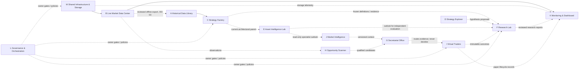

# ATLAS Quant Lab — Department Interfaces & Responsibility Boundaries
**Version:** 1.1-DRAFT | **Evidence snapshot:** 2026-10-24
**Main source baseline:** `4e4c3537036bdf2b106c1a63ec65b2a9855972a7` | **Documentation:** PR #74, Draft/unmerged.
Reviewed documentation baseline: `e4ce1c8a5d7911f52fb67e52f7e58c2e0ee5b476`; final document HEAD is in PR metadata/correction matrix, not the main-source SHA.
Evidence IDs and scope: [09_EVIDENCE_REGISTER.md](09_EVIDENCE_REGISTER.md). No production authorization or owner decision is created by this map.

---

## 1. Data Ownership Map

| Data Type | Canonical Owner | Source | Consumers |
|-----------|----------------|--------|-----------|
| Raw OHLCV bars (live) | Live Market Data Center (B) | Binance WS | G1 Operational Store → future Secretariat |
| Raw OHLCV bars (historical) | Historical Data Library (A) | Authorized offline fixtures; future versioned export, no automatic G1 feed | Strategy Factory (C), Research Lab (F) |
| Versioned indicator results | Strategy Factory (C) | Historical Library | Research Lab (F), future Scanner (H) |
| Strategy definitions | Strategy Factory (C) | Owner-declared | Research Lab (F), Virtual Traders (I) |
| Paper trade records | Virtual Traders (I) | Trader decisions | Research Lab (F), Monitoring (K) |
| Health snapshots | Shared Infrastructure (M) | Journal + Store | Monitoring (K) |
| Architecture decisions | Governance (L) | Owner approvals | All departments |

---

## 2. Verified Interface Contracts (VERIFIED IN MAIN)

### A → C: CustodyAccessor
```python
accessor.range_query(
    dataset_id: str,
    start_ms: int,
    end_ms: int,
    decision_cutoff_ms: int,
    *,
    version: int | None = None,
    require_complete: bool = True
) -> list[HistoricalBar]
```
- `require_confirmed_availability=True` enforced internally
- Bars with `observation_cutoff_ms > decision_cutoff_ms` are excluded
- `require_complete=False` allows partial-window queries

### B → M: DurableJournal write
```python
journal.commit(bar: MarketBar, *, background=False) -> bool  # True=new row, False=duplicate
journal.replay(symbol=None, interval=None, final_only=True, *, pending_only=False, limit=None) -> list[MarketBar]
journal.mark_persisted(stable_key: str) -> None  # after store success; no acknowledge() method
```

### M → M: OperationalStore upsert
```python
store.upsert(bar: MarketBar) -> bool  # UNIQUE(symbol,interval,bar_open)
store.get_stored_keys(symbol, interval) -> set
store.get_range(symbol, interval)  # returns min/max stored opens
```

### B → M: GapRecovery
```python
recover_gap(
    symbol, interval, gap_start_ms, gap_end_ms,
    existing_keys: set
) -> tuple[list[MarketBar], RecoveryReport]
# pipeline._run_gap_recovery handles commit(background=True), upsert, mark_persisted
```

### C → C: IndicatorLibrary (V1)
```python
indicator.compute(
    accessor: CustodyAccessor,
    dataset_id: str,
    start_ms: int,
    end_ms: int,
    decision_cutoff_ms: int,
    *,
    version: int | None = None,
    require_complete: bool = True
) -> tuple[list[IndicatorResult], IndicatorManifest]
```

### C → C: StrategyDefinition (SF-STRAT-01)
```python
StrategyDefinition.from_json(raw: str) -> StrategyDefinition  # validates + canonicalizes
definition.digest  # SHA-256 of canonical JSON
bind_evaluation(definition, accessor, dataset_id, version, start_ms, end_ms,
                decision_cutoff_ms, *, registry=None) -> EvaluationBinding
candidate_grid(definition, axes, *, registry=None, maximum=256) -> tuple
# AttemptRecorder(sink): caller-owned persist-or-raise port, not a durable journal
```

---

## 3. Responsibility Boundaries

### B ↔ M: Durability Boundary
- **B owns:** WebSocket connection lifecycle, bar ingestion, gap detection
- **M owns:** durable commit (journal), idempotent store write, health state
- **Rule:** B never writes directly to operational store; always via journal → consumer → store
- **Evidence:** `lanes.py` `JournalConsumer` pattern; "Store success (including an existing key) precedes ACK"

### A ↔ C: PIT Boundary
- **A owns:** bar custody, availability metadata, `manifest_integrity_hash`
- **C owns:** indicator computation, provenance hashing, strategy binding
- **Rule:** C never constructs `CustodyAccessor` with bars from the future; `decision_cutoff_ms` enforced
- **Evidence:** `historical_library.py` `require_confirmed_availability=True`

### G ↔ I: Decision Authority Boundary (DESIGNED — not implemented)
- **G (Secretariat) owns:** routing observations to the correct trader's secretary
- **I (Trader) owns:** entry/exit decisions based on frozen strategy rules
- **Rule:** Secretariat does NOT decide fills, exits, or strategy outcomes
- **Evidence:** `01_CONTRACT.md` DATA-07: "The owning trader evaluates and decides; the monitor/secretariat does not independently decide outcomes or create fills (G1-ARCH-05)"

### H ↔ I: Candidate vs. Decision Boundary (DESIGNED — not implemented)
- **H (Scanner) owns:** candidate qualification, stage management (WATCH→ARMED→READY)
- **I (Trader) owns:** final entry decision with complete mandatory evidence
- **Rule:** Scanner READY ≠ trade permission; trader decides independently

### C ↔ F: Research Isolation Boundary (partial contracts implemented)
- **C owns:** strategy definitions, indicator results, provenance
- **F owns:** experiment registration, paired evaluation, holdout custody. Those components have unmerged isolated implementations; accepted-main orchestration is missing.
- **Rule:** Holdout data must never be accessible during strategy development
- **Rule:** Historical development / OOS / forward sections must remain separate

---

## 4. Circular Dependency Check

| Dependency | Direction | Risk |
|-----------|----------|------|
| `research_wp_r0` → `src/aql` | No cross-import in inspected main; explicit static guard | Import policy only, not a runtime security sandbox |
| `src/aql` → `research_wp_r0` | NONE | ✅ Safe |
| Secretariat → Trader | Secretariat routes TO Trader | ✅ One-way |
| Scanner → Trader | Scanner routes TO Trader | ✅ One-way |
| Trader → Research Lab | Trader produces data FOR Lab | ✅ One-way |
| Research Lab → Strategy Factory | Lab consumes FROM Factory | ✅ One-way |

No runtime cross-import cycle was identified in inspected main. Proposed future feedback loops need versioned immutable artifacts, queues, authority limits and independent schedules; arrows alone do not prove absence of runtime coupling.

---

## 5. Version Compatibility Rules

| Contract | Version Policy | Evidence |
|---------|---------------|----------|
| `CustodyAccessor` dataset versions | Integer version parameter | `historical_library.py` |
| `IndicatorLibrary` V1 | Additive only; V1 bytes/APIs unchanged | `indicator_library_v2.py` docstring |
| `StrategyDefinition` | SHA-256 digest pins version | `strategy_definition.py` |
| Bar schema | `09_DATA_SCHEMAS.md` versioned | `01_CONTRACT.md` |

**Rule:** All schema changes require ADR (per `01_CONTRACT.md`). No breaking changes to existing contracts without version bump.

---

## 6. Who Owns What Decision

| Decision | Owner | Evidence |
|---------|-------|----------|
| Strategy promotion | Project owner only | `02_ROADMAP.md` G4 |
| Holdout release | Project owner only | `01_CONTRACT.md` TIME-05 |
| Architecture changes | Project owner (ADR) | `01_CONTRACT.md` |
| Paid service activation | Project owner | `01_CONTRACT.md` DATA-03 |
| Merge to main | Project owner | Governance protocol |
| Entry/exit trade decision | Owning Virtual Trader | `01_CONTRACT.md` DATA-07 |
| Indicator technical validity | Shared Indicator Box manager | G1-ARCH-21 (designed) |
| Strategy-manifest eligibility | Trader's Secretary | G1-ARCH-22 (designed) |

## 7. Storage, research ancestry and ownership proposals

- #73 archive reads journal read-only; its catalog ACK is independent of existing local/remote ACKs. No pipeline activation or decision capture is implied. Optional backup snapshots are individually coherent, not a global transaction.
- #46 DurableTrialJournal.record_attempt requires typed Attempt plus event_id; main AttemptRecorder emits dictionaries. These cannot be connected implicitly. #78 prepares immutable inputs only and leaves successful preparation PENDING, not COMPLETE.
- B owns acquisition/freshness/provider budgets; A owns versioned data eligibility/coverage; C owns immutable definitions and reusable indicator algorithms; F owns independent evaluation/contamination accounting; I alone owns trade entry/exit. M owns persistence/recovery primitives, not trading decisions.
- Proposed PIT decision chain: I produces immutable decisions/outcomes, G routes, M persists, F evaluates. Runtime producer/journal and coverage policy remain unimplemented and need a scoped package.
- E stays under C (#72). J supplies broad cross-market context; E supplies asset-specific research. AssetOutlook consumers must opt in, enforce TTL/validation/missingness and never turn an outlook directly into an order/risk command. F validates claims independently. K observes, L/owner approves policy.
- Lightweight trigger watch is future: shared streams, completed time-window semantics, confirmation/contradiction/non-occurrence/material-change evidence, bounded deduplicated reassessment jobs. Heavy analysis stays outside core queues. UNKNOWN data is not a failed thesis.
- OD-02/03/05 recommend shared computation specifications with separate research/live receipts, an offline artifact bridge first, and distinct broad-context versus specialist-outlook contracts. These are proposals, not new implementation authorization.

## 8. Thirteen-area dependency map

Solid arrows denote inspected main software inputs. Dotted arrows denote
designed/future artifact, policy or oversight relationships, not deployed
services, implementation authorization or synchronous calls. E remains under C;
D placement as an F hypothesis function is a recommendation, not an approved
reorganization.



B→K refers only to existing structured health; a graphical dashboard is future.
Operational indicators/secretarial subscriptions still require the separately
reviewed live Indicator Box boundary. M supplies shared persistence primitives;
it does not own trading eligibility. Future feedback/reassessment topics require
bounded queues, idempotency and stable versions, never an implicit import cycle.
