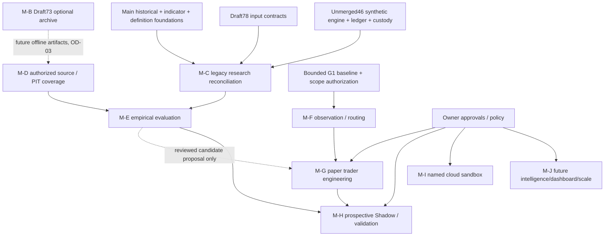

# ATLAS Quant Lab — Master Development Roadmap
**Version:** 1.1-DRAFT | **Evidence snapshot:** 2026-10-24
**Main source baseline:** `4e4c3537036bdf2b106c1a63ec65b2a9855972a7` | **Documentation:** PR #74, Draft/unmerged.
Reviewed documentation baseline: `e4ce1c8a5d7911f52fb67e52f7e58c2e0ee5b476`; final document HEAD is in PR metadata/correction matrix, not the main-source SHA.
Evidence IDs and scope: [09_EVIDENCE_REGISTER.md](09_EVIDENCE_REGISTER.md). No production authorization or owner decision is created by this map.

## 1. Preserve canonical gates; remove unsupported dates

The canonical [02_ROADMAP.md](../02_ROADMAP.md) defines:
G0 governance; G1 market foundation; G2 observation (including4/24/72h outcomes);
G3 Momentum Trader; G4 Research Lab; G5 events; G6 multi-trader expansion.
This package does not rename G2 as Research Foundation, G5 as general
intelligence or G6 as Dashboard. Independent research foundations and bounded
storage work may proceed in parallel under their specific authorization.

No defensible elapsed-time forecast is available: one-task completion times,
CI seconds and synthetic benchmark timings do not measure remaining engineering
velocity, available sustained staffing, review latency or forward data adequacy.
The old serial totals and percentage parallelism discounts are withdrawn, not
converted into promises. No date for first paper trade is asserted.

## 2. Work already delivered; avoid duplicate implementation

| Work | Actual state | Remaining work |
|---|---|---|
| Historical library/Indicator V1/guard | Merged #57/#60/#63 | Preserve contracts; obtain admissible dataset coverage |
| Indicator V2/Strategy JSON | Merged #68/#69; #66 closed; main216-case acceptance complete | Native offline binding exists; no full Factory engine |
| G1 pipeline | Merged #32/#40/#42/#45/#62 | Bounded Binance report accepted; sustained/unattended/scale remain unvalidated |
| Storage direction | #67 Option B conditionally DECIDED | Final ADR/operating budgets; no new Free-vs-Pro binary decision needed now |
| Phase1 archive/backup | Draft73 cb7829e; technical READY FOR OWNER MERGE APPROVAL,60 cases×6 CI | Owner merge decision; production/offsite activation separately gated |
| Research R0–R40/Batch01 | Code/tests in unmerged #46 ancestry, legacy204-case CI | Reconcile existing temporal/ledger/engine interfaces with main, not rebuild from zero |
| Historical input adapter | Draft78,393 cases×6 CI; #77 full milestone BLOCKED | Owner review, identity/ledger reconciliation and real data |
| Asset Intelligence | #72 owner-approved future concept under C, unscheduled | No current implementation task; preserve initial request + future bounded reassessment design |
| Supabase | Main adapter/migrations/disposable PostgreSQL tests | #65 named cloud sandbox permission and least-privilege/TLS/RLS acceptance absent |

## 3. Milestone dependency and acceptance plan

| Milestone | Required inputs / real dependency | Permitted parallel work | Acceptance / owner gate |
|---|---|---|---|
| M-A Documentation/contract reconciliation | This PR74, canonical contracts, latest decisions | Owner resolves OD-01/02/03/05; no runtime changes | Ten coherent docs, scoped evidence and owner architecture approval; no auto-merge |
| M-B Optional archive acceptance | Conditional Option B; corrected Draft73 | Owner disk/media/encryption/RPO/RTO planning | Exact-head tests + virtual integration already green; separate merge approval. Activation/off-device/retention deletion not implied |
| M-C Research-line reconciliation | Main foundations + #46 typed family/journal/temporal contracts + Draft78 | Offline contract/data inventory, static compatibility review | Explicit staged adapter/migration plan, complete candidate accounting and restart/anchor tests before formal empirical runs; avoid silently importing divergent chain |
| M-D Admissible research dataset | Authorized offline source, rights, version/units/symbol/listing/adjustment/receipt metadata; OD-03 artifact boundary | Source feasibility/coverage and library sizing | Frozen scope, gaps/missingness/quality/PIT classifications and retained commitments; no automatic use of operational feed or retrospective receipt promotion |
| M-E Reproducible historical evaluation | M-C and M-D; preregistered family/splits/baselines/costs, protected final holdout | Synthetic software fixtures without empirical claims | Deterministic input/result lineage, full population including failures/no-fill, purged/embargoed splits, dependence/multiplicity/sample evidence; independent review before confirmatory/forward claims |
| M-F Observation/secretariat/scanner | G1 authorized scope and provisional G2/data-service contracts | Design/fixtures can proceed independently of offline experiments when explicitly authorized | Trader-owned decisions preserved;4/24/72h outcome maturity/missingness, feed/latency/backpressure and resource isolation evidence |
| M-G First paper trader | Frozen strategy/version, routed mandatory context, deterministic fees/slippage/expiry/ambiguity/recovery | Simulator fixtures and interface specs, not live activation | Signal replay, full denominators, restart/no duplicates, owner paper-operation authorization; profitability is not required for engineering completion |
| M-H Prospective Shadow/validation | Frozen parent/variant protocols, approved data path and forward start timestamp | Build report contracts while data accumulates | Observe prespecified horizons/sample rules; no backdating, retrospective Shadow claims or final-holdout tuning. Independent validation + owner promotion decision |
| M-I Cloud projection acceptance | Separately authorized named disposable sandbox; selective schema/quota plan | Local storage/research do not wait synchronously on cloud | TLS/identity/least-privilege/RLS/denied operations/replay/quota evidence in that sandbox; no routine cloud candle archive |
| M-J Intelligence/events/dashboard/scale | Owner prioritization + source/rights/resource/record availability | Read-only contracts, source feasibility, bounded tests | #72 remains future; later event/trigger/TTL/isolation/consumer-policy tests. Dashboard consumes actual records; multi-trader and scale follow canonical gates |

Cloud validation, R09 issuer-side remediation and off-device provisioning have
external authorization/evidence dependencies. They are not invented serial
prerequisites for all offline synthetic research development. None of this
waives the production gates or owner-required disposition of remaining G1 work.

## 4. Dependency map (work packages, not automatic execution permission)

Archive completion is not a synchronous Core Run prerequisite. The data bridge
must retain provenance and actual receipt uncertainty. Candidate/evaluation
output is not automatic trader activation. Arrows denote inputs, not new
department placements or approved sequencing outside existing stage gates.

## 5. Resources, elapsed time and forward evidence

No dedicated sustained engineer count, task-size history or measured review
throughput was supplied. Several tools/tasks completing on one day is not a
staffing forecast; no agent/conversation capacity is assumed. Before scheduling,
estimate only the scoped remaining delta per milestone, list implementer/reviewer/
owner availability, account for rework and interface reconciliation, and update
ranges from actual completed comparable work. No calendar range is published
without those inputs.

Forward4/24/72h observations require actual elapsed horizon completion, source
availability and enough eligible independent occurrences for the declared claim;
they cannot be compressed by parallel coding. There is no requirement to wait
for every conceivable regime before engineering completion, nor permission to
claim validation merely because a horizon elapsed. Record confidence and
unresolved missingness, separate historical-development/OOS/forward evidence,
and prefer quality/scalability over the earliest first trade.

#71/#67/#64/#65/#77 remain open at this snapshot; technical delivery, owner
acceptance, merge and production authorization are separate state transitions.
