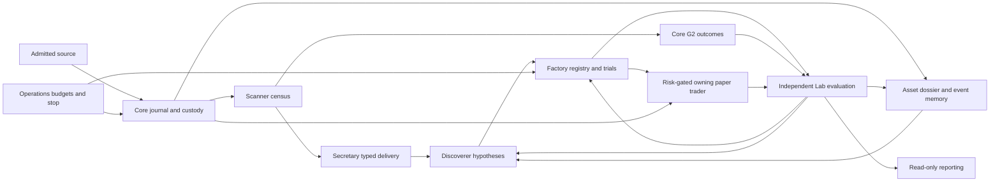

# ATLAS Quant Lab Architecture v1

**AQL-CRYPTO-RESEARCH-001 · 2026-11-11 · Owner-selected provisional design, pre-freeze.**
[Assignment #306](https://github.com/scannercrypto0-gif/super-kumo-v8/issues/306) · [Contracts](architecture-v1-contracts.md) · [AI, ML and Asset Intelligence](architecture-v1-intelligence.md) · [Coverage and acceptance](architecture-v1-acceptance.md)

## Objective and boundaries

ATLAS is a personal noncommercial crypto research lab. It turns admitted market observations into reproducible hypotheses, tests them against frozen baselines and costs, and learns from failures and unselected opportunities. BTCUSDT Spot is the first bounded lane. Preserve the existing modular monolith, shared market-data foundation and separate research/runtime lanes. The target allows automatic research, qualified promotion and real-time simulation. The current delivery only specifies that target. Live orders and actionable real-time Telegram recommendations require separate owner grants at use time. Phase or service activation, final holdout access, new paid sources and provider use retain their own governance gates. A B0 placeholder exercises engineering paths only.

## Evidence and continuity

Base main is [90af979](https://github.com/scannercrypto0-gif/super-kumo-v8/commit/90af9794880cbeb00e7e974bfa906ff5e9666183). Read [system map #202](https://github.com/scannercrypto0-gif/super-kumo-v8/issues/202), [PM #205](https://github.com/scannercrypto0-gif/super-kumo-v8/issues/205), [PM OS v1](https://github.com/scannercrypto0-gif/super-kumo-v8/issues/205#issuecomment-6721828613), [v1.1](https://github.com/scannercrypto0-gif/super-kumo-v8/issues/205#issuecomment-6721846844) and [v1.2](https://github.com/scannercrypto0-gif/super-kumo-v8/issues/205#issuecomment-6741235513), [G0-GOV-01](../03_DECISIONS.md#g0-gov-01--work-handoff-continuity-and-completeness), [whole-system Audit](https://github.com/scannercrypto0-gif/super-kumo-v8/issues/134#issuecomment-6794166523) and [Asset Intelligence Audit](https://github.com/scannercrypto0-gif/super-kumo-v8/issues/134#issuecomment-6794354966).

| Accessible continuity record | What it establishes |
| --- | --- |
| [March owner handoff](https://github.com/scannercrypto0-gif/super-kumo-v8/pull/271#issuecomment-6738081809), [one-shot consumed](https://github.com/scannercrypto0-gif/super-kumo-v8/pull/271#issuecomment-6738655796) | Historical owner evidence, no permission to replay. |
| [Prospective scope](https://github.com/scannercrypto0-gif/super-kumo-v8/pull/271#issuecomment-6741012105), [host evidence](https://github.com/scannercrypto0-gif/super-kumo-v8/pull/271#issuecomment-6792056958) | #286 72h pending following interruption. The owner supplied host readiness evidence later recorded by PM. It does not qualify data or demonstrate a pilot. |
| [Latest accessible actual owner-sourced pilot handoff](https://github.com/scannercrypto0-gif/super-kumo-v8/pull/271#issuecomment-6790077125), [source adjudication](https://github.com/scannercrypto0-gif/super-kumo-v8/issues/302#issuecomment-6790283651) | One scoped conditional read-only pilot; owner attests eligibility and rights, applicable provider terms and shared-IP eligibility remain evidence gates. |
| [Combined offline receipt](https://github.com/scannercrypto0-gif/super-kumo-v8/pull/271#issuecomment-6790421248), [later transport delta](https://github.com/scannercrypto0-gif/super-kumo-v8/pull/271#issuecomment-6790809339) | Composite is pinned to older #305 head e440b91. Later e2b7870 standalone CI establishes offline transport evidence only. Spot pilot NOT_RUN. |
| [Current owner design handoff #306](https://github.com/scannercrypto0-gif/super-kumo-v8/issues/306) | Latest directly received architecture handoff: provisional B for departments, Asset Intelligence and AI/ML, plus explicit automatic paper policy and separate owner-only grants. Supersedes prior per-strategy paper approval in the target scope. |

Private chats and owner files are UNKNOWN. GitHub reports are graded as reports unless independently attested. Issue [#1](https://github.com/scannercrypto0-gif/super-kumo-v8/issues/1) records October 22 baseline G0 approval with R09 deferred. “Pre-G0” here refers to the **Architecture v1 freeze**, which remains pending. Preserve legacy rotation/revocation verification before any reuse. No draft is assumed merged.

## Responsibilities and maturity

Logical roles can share a process. Each named writer owns its state even when tables share a database. Evaluators consume immutable records. PM coordinates stage closure and Audit reviews material claims and releases.

| Owner and state | Input → output → immediate consumer | Evaluator and fallback | Evidence |
| --- | --- | --- | --- |
| Core G1 / Historical Library: source admission, clocks, finalized bars and custody | Authorized wire/archives → source and query receipts → Scanner, Factory, Asset Intelligence | Core integrity, Audit external claims; quarantine unknown identity/gaps | MAIN journal/store and custody; DRAFT #287 852f6fc, #304 e0e08a8, #305 e2b7870 |
| Core G2: frozen observation/outcome lineage | Decisions and final bars → 4/24/72h outcomes → Lab | Lab checks maturity and comparability; pending or UNKNOWN | MAIN offline [contract](core/g2_observation_contracts.md); DRAFT #286 d072544 and #289 1ff3d13 |
| Scanner: opportunity census and screening state | As-of data and pinned universe → signal/NO_SIGNAL/UNKNOWN census → Secretary and G2 | Integration checks completeness; missed/denied rows preserved | MAIN bounded Generic H; DRAFT #277 ccf57ad |
| Secretary: delivery obligations; Integration: release composite | Typed references → per-recipient receipt and reconciliation → producers/consumers | Integration engineering; WAIT or dead-letter | DRAFT #261 40ad0b4, #271 182331b; MAIN Generic H typed research does not route |
| Discoverer: hypothesis identity and generation attempts | Census and feedback → candidates/family → Factory | Factory checks novelty/inputs; record rejected/duplicate attempts | DRAFT #276 c568e3b |
| Factory: strategy/experiment/model registries and lifecycle projection | Hypotheses and admitted cohorts → trials, versioned results → Lab | Lab independent verdict; freeze/quarantine inconsistent artifacts | MAIN [Generic H](research/generic-h-main-research-authority.md); DRAFT #267 04b63cc, #291 ea4ffd5, #297 dd3e149, #300 403e247 |
| Research Lab: protocol and scientific verdict | Sealed trials/G2/paper outcomes → evaluation/negative feedback → Factory, Discoverer, Asset Intelligence | Audit at material/stage claims; insufficient evidence stays explicit | DRAFT #301 8adea8c, #296 eb49308 retrospective |
| Risk: policy and veto; owning trader: decisions, paper positions and simulated ledger | Eligible release and fresh inputs → simulated intents/positions → Lab, Reporting | Operations verifies limits/recovery; suspend entries, manage exits by frozen policy | DRAFT #288 0ca716e isolated simulator; real-time Paper DESIGN |
| Core: asset identity/features and event versions; Factory specialist: outlook and trigger state | Core evidence → dossier/outlooks/events → opted-in Lab, Discoverer, Scanner/Secretary research views | Lab tests incremental value; stale/UNKNOWN context | DESIGN [#72](https://github.com/scannercrypto0-gif/super-kumo-v8/issues/72), [#80](https://github.com/scannercrypto0-gif/super-kumo-v8/issues/80) |
| Intelligence Gateway: retrieval receipts; Factory AI/ML: optional model and response records | Approved evidence → advice, shadow, inference → Lab/opted-in research | Lab paired baseline; drop invalid output, baseline continues | DESIGN [#84](https://github.com/scannercrypto0-gif/super-kumo-v8/issues/84), [#79](https://github.com/scannercrypto0-gif/super-kumo-v8/issues/79) |
| Reporting: projections and delivery receipt; Owner: grant and revocation | Immutable journals → read-only reports or separately gated actionable signals | Operations verifies publish controls; suppress expired/ambiguous sends | DESIGN unified reporting/Telegram; actual action disabled |
| Operations: budget, lease, stop, clock health and recovery | Core/Integration demands and receipts → shared reservations, health → runners and reporting | Audit reviews stage evidence; backpressure/exclusive operation | MAIN local primitives; shared authority DESIGN |
| PM: decision/stage register; Audit: independent verdict | Evidence and decisions → scoped release criteria, findings → owner and teams | Owner freeze decision; unresolved claims stay gated | Existing #205/#134 records; no runtime implied |

[Core #180](https://github.com/scannercrypto0-gif/super-kumo-v8/issues/180), [Factory #77](https://github.com/scannercrypto0-gif/super-kumo-v8/issues/77), [Factory #254](https://github.com/scannercrypto0-gif/super-kumo-v8/issues/254), [source governance #273](https://github.com/scannercrypto0-gif/super-kumo-v8/issues/273) and [department map](../atlas_map/03_DEPARTMENT_INTERFACES.md) supply prior contract context. Drafts are references to pinned evidence. The GitHub PR number resolves each pin's evidence and ancestry.

## Flow and failure boundaries

The position monitor prioritizes and independently fans out observations. The trader alone evaluates entry, exit and recovery. Scanner screening and secretary readiness never mutate trader positions. G2 matures frozen decisions on independent windows in parallel with research. Feedback creates new hypotheses or versions. Original decisions and rejected attempts remain immutable. A correction makes a new source version and triggers dependent invalidation. Operational reports use allowed read-only projections and preserve coverage, age, gaps, queue lag, clock health, spend and stop state.

## Decision register

| Decision | Disposition and owner |
| --- | --- |
| ARCH-P0-01 | Propose single typed envelope and explicit custody, recipient ACK, terminal state and reverse routes over existing durable journal/registry. Integration owns transport and reconciliation. Recipient owns its ACK. [Wire contracts](architecture-v1-contracts.md). |
| ARCH-P0-02 | Factory records lifecycle using independent Lab and risk evidence. Paper auto-enables only within an activated phase and frozen policy. Owner personally grants Telegram and LIVE separately. [Authority specification](architecture-v1-contracts.md#lifecycle-and-permissions). |
| ARCH-P0-03 | Operations owns shared provider/IP budgets, leases and recovery, with Core/Integration supplying usage. Protect open positions first. Maintain sequential exclusivity across #286/#305 on shared egress while common enforcement is unproven. Neither run is modified by this proposal. |
| Owner policy delta | Historical [TIME-05 and owner F](../03_DECISIONS.md#g0-time-05--historical-research-vs-forward-performance-c), [contract](../01_CONTRACT.md), [roadmap G4](../02_ROADMAP.md), and [map ownership](../atlas_map/03_DEPARTMENT_INTERFACES.md#6-who-owns-what-decision) use owner-only promotion wording. #306 controls the proposed research/paper scope. Before production contract migration owner freezes the cross-document policy delta. Existing approvals, actual holdout custody and operational grants retain original scope. Earlier #72/#79 optional binding influence proposals stay opt-in, staged and research-only until a separately ratified policy admits the use. |
| Asset/AI/ML B | Core-backed read-only BTC dossier, on-demand bounded Factory specialist and lightweight reassessment. Replaceable AI/ML with Lab evaluation. No fourth P0 dependency. |
| Open engineering configuration | Integration picks existing transaction/outbox binding after exact release-tree review; Risk freezes numerical caps, market realism and stale-exit policies; Lab freezes split/metric thresholds; Operations establishes measured budgets/clock SLO and exact provider terms. Incomplete policies deny activation. These are implementation inputs, not additional per-candidate approvals. |
| Remaining owner decisions | Architecture v1 freeze and ratification of the scoped historical promotion-policy update. Any future paid service, final holdout release, live grant or Telegram grant follows its existing distinct authority. No permission inferred from this package. |

## Incremental roadmap

- **P0** Review and freeze architecture decisions. Preserve existing Generic H research-only guard and pinned draft proofs. Establish an exact release tree and map adapters to native schemas before any runtime work.
- **P1** Close the authentic BTC vertical slice using eligible source, exact pinned handoffs and independent lab science. Mature prospective evidence and then qualify the automatic paper path with safety, isolation and recovery tests. BTC asset dossier starts as a read-only research projection when prioritized. No #286/#305 concurrency on unverified shared IP.
- **P2** Add lawful macro/event sources, optional asset outlook consumers and bounded AI/ML protocols, independently validated. Expand to more assets only with source identity, chronology and cost evidence. Telegram and LIVE are independent gated release tracks.
- **Release** Record ancestry and content pins for every selected draft. #305 depends on #289; #297/#301 stack on Factory #291; #293/#284 are Integration branches. Use a separately authorized release tree with Windows/Ubuntu smoke and adverse replay at the combined SHA. Standalone CI and earlier composite evidence stay attached to their original heads. Consult [references #278](https://github.com/scannercrypto0-gif/super-kumo-v8/issues/278), [improvements #279](https://github.com/scannercrypto0-gif/super-kumo-v8/issues/279) and [phase gates #280](https://github.com/scannercrypto0-gif/super-kumo-v8/issues/280) when due.
