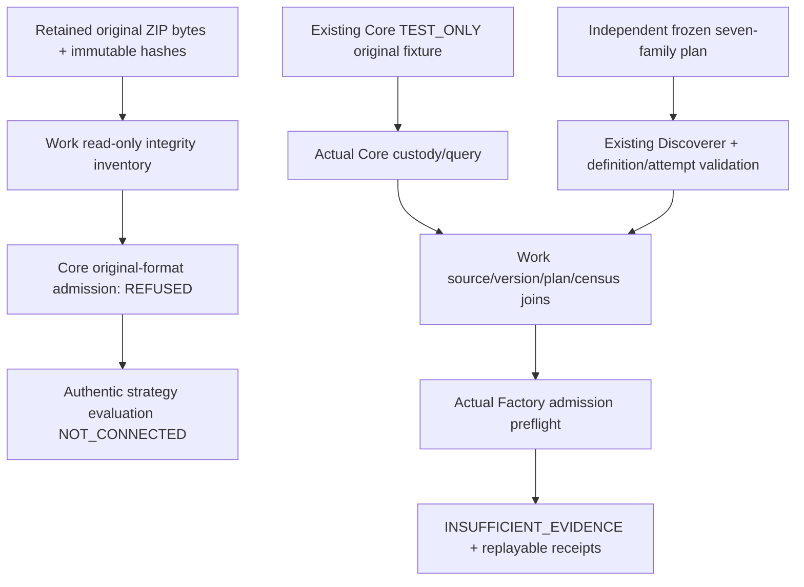

# Issue239 — Original historical source / independent Discoverer / Factory

Owner explicitly dispatched [Issue239](https://github.com/scannercrypto0-gif/super-kumo-v8/issues/239)
(2026-11-04, provisional A). G0 remains pending. This isolated Work delta is
stacked on accepted-in-scope TEST_ONLY Work#235 `6acbcc7fc243b132f58170df4c6469bbf7f4eff8`.
It writes only NEW `tools/historical_research_integration/**` and one NEW scoped
workflow. The Scanner/Paper operational lane and all prior owner code remain
unchanged. No Claude/Antigravity, new engine, private experiment, source download,
holdout access, paper/live activation, merge or G0.

## Actual source access, not an invented missing-file blocker

Work actually reopened the retained owner-authorized P2A source package, verified
its outer SHA/CRC and the original February/August BTCUSDT Spot15m ZIPs, retained
vendor CHECKSUM bytes and original CSV member hashes. A current connected-file
metadata lookup also resolved the retained package (same filename/size). No
reupload or live Binance access was required. No raw market data or private
locator is published here. [SOURCE_ACCESS_OBSERVATION.json](SOURCE_ACCESS_OBSERVATION.json)
is a sanitized canonical observed-evidence receipt, **not a synthetic source**.
Its existence in CI is a record of Work's observation, not independent CI access
to private originals or independent Audit authentication.

| Retained original | Archive SHA256 | CSV member SHA256 | Native bars |
|---|---|---|---|
| BTCUSDT-15m-2024-02.zip | `55066890cd3a76c97c05e94213311b17a4146d697f6abe8762b3edae8495b20e` | `7621f87a8fa1d2588fdaebacdd30333d2feaa05b453118c7c697f17aa27f4720` | 2784 |
| BTCUSDT-15m-2024-08.zip | `44e084e916a4c661b2177741d71438916388c0d34554f63cb147973aac13b094` | `54fecf17078a8fb0d1a6ec16be6a64003947bf411e2697ced2815162cb69a7b0` | 2976 |

Outer retained package SHA256:
`95b2f2a8b5fb952d0086c2f33046e0560e0076846d228dc239bb89fc1b6d2665`.
Both original grids are dense single-symbol archived grids; that is not a complete
historical market universe. The retained intake explicitly records
historical_known_at_ms=NULL, historical_publication_ms=NULL, availability
RETROSPECTIVE_NON_PIT, correction history UNKNOWN. Its 2026 fetch/capture record
cannot prove what was known at 2024 decision clocks. Matching a checksum retained
from the same source is local byte integrity, not a signature/independent chronology.
Source access is **AVAILABLE_RETAINED_ORIGINAL**, scientific admissibility remains
**UNVERIFIED / AUTHENTIC_NOT_CONNECTED**, not SOURCE_NOT_AVAILABLE.

Work also made two actual bounded Core admission attempts with those original ZIP
bytes. Current Core rejected both with `UNSUPPORTED_ORIGINAL_SOURCE` before staging:
it supports SEALED_ARCHIVE_QUERY or RAW_VAULT_CSV (seven columns), whereas original
Binance monthly archives contain a 12-column native CSV. No seven-column derivative
was relabelled as original, no original archive manufactured, no availability
clock backdated and no candidate/Factory scoring was run on these private originals.

## Exact pinned source/contract map

| Component | Exact pin | Actual contract / invocation |
|---|---|---|
| Core#226 / #237 | `668b02074621a3671b3485625ca264a987afe955` | `admit_original_bytes`, `aql.core.external-original-byte-pin.v1` → `aql.core.historical-original-admission.v1`; actual existing Bridge/library/query |
| Factory#241 / #238 | `7803a12cdb0c7bfead0b50c521d9110c6254d383` | `assess_research_admission`, `aql.factory.authentic-research-admission.v1` → `aql.factory.authentic-research-gate.v1` |
| Discoverer#230 | `f2006c0e431690ccea8b0532095bf4f2a2dc88ba` | Existing seven-family/template registry, no copied rules/families |
| Work#235 | `6acbcc7fc243b132f58170df4c6469bbf7f4eff8` | Existing independent generator/AttemptRecorder adapter; no Scanner dependency; old descriptive fixture is not used as strategy performance |
| Work#228 | `607e88d69e9450ae66fd5090317c5c296ade8457` | Existing content-addressed create-only ReceiptStore / bounded local attempt journal |
| Merged main contracts | inherited unchanged in #235 | StrategyDefinition, IndicatorRegistryV2 and candidate_grid; no new interpreter or evaluator |

Existing Core#237 and Factory#238 delivery/code/CI and prior Audit#233/6624462958
were reviewed. Audit accepted #235 only for TEST_ONLY; authentic connectivity was
CHANGES_REQUIRED. Core#237 originally could not see Work's retained private source;
this new observation closes Work's file-access uncertainty, **not** its trust/PIT
or source-format/evaluator boundaries. No inaccessible conversation is claimed read.
All actual dependency file hashes are in `fixtures/dependencies.json`.

## One coherent integration and honest boundary



Core metadata/query is not a price-bearing original OHLCV grid. Source, pin,
packet, registration, manifest, query, correction parent and decision cutoff are
preserved and joined. Partial/unknown/missing grids are never scored as complete.
All current Core attestation flags remain NOT_ATTESTED/BLOCKED; a forged caller
boolean cannot create a reviewed verifier. No fake authentic source or zero hash
is supplied when bytes are absent. Explicit no-source response is SOURCE_NOT_AVAILABLE.

Generation uses existing #235 independent family builders/grid/attempt handling.
The small `GenerationOnlyPort` deliberately records `GENERATION_ONLY_FACTORY_NOT_CALLED`
until the complete trial census exists. It returns a deferral, never a fabricated
Factory result. Then this module invokes the **actual new #241** admission API
with finalized attempts grouped by immutable definition identity and a commitment
to the complete global trial census. Invalid/budget attempts without a valid
definition remain explicit unrouted attempts; duplicate attempts bind prior IDs
and remain counted. Strategy/version/definition/plan/dataset/source/cutoff are
rechecked; no pre-existing descriptive opportunity fixture is attached to a new
strategy. Feature availability stays NULL when unknown, not fabricated at cutoff.

The critical TEST_ONLY gate uses all seven existing families: **53 draws /53 valid
unique definitions /53 native Factory admission attempt slots**. Each proposed
candidate reaches a real preflight receipt with scientific_result INSUFFICIENT_EVIDENCE,
strategy_rule_trigger_evaluation NOT_PERFORMED, source/PIT false, cost model NOT_APPLIED.
This is a practical candidate→Factory **admission** report, not strategy performance.
Full market opportunity/BASE/SHADOW/observation denominators remain NULL/UNKNOWN;
no fabricated arms, next-bar signals, prices, fills, costs, statistical significance
or profitable alpha are invented to complete those missing boundaries.

## Why the authentic calculation is still blocked

1. Retained sources exist, but no independently admissible 2024 publication/known-at
   and correction/universe chronology has been supplied. Captured archive bytes
   remain RETROSPECTIVE; no live Binance prerequisite is introduced.
2. Core's exact original format API does not accept retained Binance ZIP/12-column
   bytes. The minimal owner-controlled adapter belongs at
   `aql_authenticated_historical_admission_v1.py` / `aql_archive_custody_bridge_v1.py`:
   bind archive SHA + original member SHA + explicit normalization lineage and
   preserve original/correction/publication clocks. Work does not change those files.
3. Core custody range is checksums/availability metadata; its accepted future
   price-bearing grid must preserve exact source/version/cutoff identity. Work
   does not synthesize a price response or pretend the current query supplies one.
4. `StrategyDefinition._expression` validates AST syntax, not historical rule triggers.
   Merged `offline_simulator.simulate_single_long` accepts an explicitly supplied
   boolean and is SYNTHETIC_ONLY; it is not a generic candidate signal interpreter.
   Current #241 is a preflight and **always** returns NOT_PERFORMED / INSUFFICIENT_EVIDENCE.
   No approved existing generic rule-trigger→native-evaluator runtime was found in
   the inspected contracts. A versioned owner-verified binding is required before
   scientific outcomes. A competing backtester/interpreter is not added here.
5. BASE/SHADOW controls, full universe/opportunity denominators and frozen modeled
   costs must come from that genuine evaluation contract. No cost arithmetic or
   experimental result can be asserted before it exists and is independently accepted.

These are concrete cross-owner critical boundaries, not a reason to request the
same retained files again or to substitute TEST_ONLY data for history. The safe
adapter and entire independently runnable regression path are delivered now;
no authentic run is claimed. Scanner→Paper lane remains untouched.

## Reproduce

Python3.11–3.13 standard library; pre-provision the exact public pinned checkouts.
The Core/Factory workers deny network and child processes. Public CI needs no
private original archive and never attempts source acquisition.

```sh
python -m tools.historical_research_integration.gate \
  --checkout main=. \
  --checkout work=/approved/offline/work-607e88d \
  --checkout core=/approved/offline/core-668b020 \
  --checkout factory=/approved/offline/factory-7803a12 \
  --checkout discoverer=/approved/offline/discoverer-f2006c0 \
  --output /approved/test-only-history-evidence
```

The plain package CLI with `--mode test-only` executes the completed regression
path without tests. `--mode inspect-retained-originals --retained-package PATH
--package-sha256 95b2f2a8...` performs **integrity inventory and current Core format
probe only**, using the full expected package SHA above; no scientific scoring.
An absent explicit package produces SOURCE_NOT_AVAILABLE. Sealed/unapproved
archive selection is refused before reading bytes. Original bytes are never edited.
No raw prices, private source paths/links or payloads are written to GitHub.

Bounds: existing store/journal limits, 8MiB per source/port input, 30s worker,
64 outer members, one CSV member per declared archive, 8MiB uncompressed member,
only the two retained development windows, existing 7-family/512 planned/256 budget
limits. Gate independently checks counts/canonical hashes/readback/fresh-run/replay,
original tamper, missing grids, correction conflict/replay, duplicate/missing trials,
plan/strategy mismatch, lookahead, forged proof, no source and sealed holdout denial.
Exact final HEAD/CI/receipt hashes and remaining blockers are posted on #239/#205;
Audit#240 receives one final consolidated review request. No G0/merge/trading claim.
