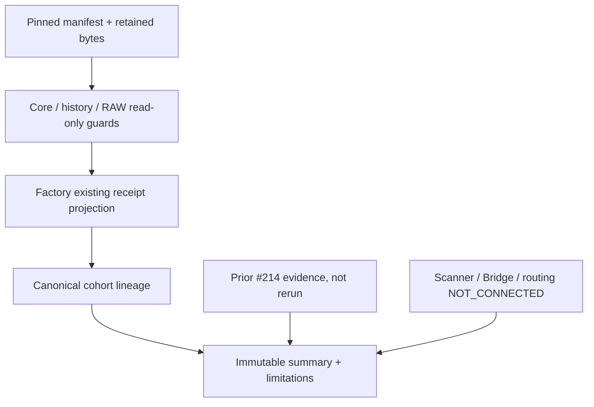

# AQL-WORK-RESEARCH-INTEGRATION-001 — offline integration delta

Current continuation: [v2 current-seam delivery and contract matrix](SEAMS_V2.md), owner-dispatched #205/6623595590 (2026-11-04). The sections below preserve the original v1 evidence and reproduction. The scoped workflow now runs the v2 gate only.

Owner dispatch: [#205/6604708623](https://github.com/scannercrypto0-gif/super-kumo-v8/issues/205#issuecomment-6604708623).
Baseline main `dbc191df72f4b4d1ebb7d490926dcad4325dac12`. Work owns only NEW
`tools/research_integration_harness/**` and ONE new workflow
`.github/workflows/aql-research-integration-harness.yml`. No other owner's paths
are modified. Draft only; no runtime activation, merge, G0 or trading authority.

## Existing work reused and new gap

The existing #214 `integration_tests/option_b_v2_cross_pr_harness.py` is an older
Core #216 / Factory #209 / Vault #211 seam with fixed machine paths, top-level
producer execution and controlled witness callbacks. It is **not rerun or copied**.
The new read-only adapter reuses its retained `option_b_v2_evidence_bundle.json`,
checks exact bytes at #214 `0f0c4377db7682187dca78b2c556b00ae1a81bab`, and preserves
its reported result and old pins as **NOT_REVALIDATED**. It does not promote
that report into current P2 or authenticated evidence. #213 is estate/release
intelligence, not a data lifecycle executor; no duplicate release analyzer added.

The new gap is immutable manifest-based integration of current P2 output
contracts, HistoricalLibrary metadata and RAW metadata, cross-cohort/availability
checks, content-addressed lineage and restart, with explicit missing connections.
No archive, scanner, custody authority, signal producer or evaluator is implemented.
The only existing Core function used to prepare the committed synthetic schedule
was `schedule_pair(..., test_only=True)`; runtime never produces schedules.
Factory fixtures are **minimal projection fixtures**, not outputs of a new or
rerun Factory evaluation. Their `fixture_origin` says so explicitly. All eight
modeled-result slots are NULL. These are not the private P2 pair identities.

## Pinned contract / ownership matrix

Exact file SHA256s and all fixture object hashes are in `fixtures/manifest.json`.
A component commit is the provenance locator; runtime hashes each actual adapter
source file before loading it. CI checks out the exact commits explicitly.

| Owner/component | Commit / PR | Actual contract consumed | Boundary/status |
|---|---|---|---|
| Core | `58e423431cc639958736337a65db8a17bfdbaa85` #221 | `aql.p2.core.paired-schedule.v1` and existing typed source/bar/opportunity/trial contracts | DRAFT_AVAILABLE; read-only typed validation and sealed schedule projection |
| Factory | `6b93abf975648d3ce5ee9c28c7b33c72686f4e6b` #222 | `aql.p2.factory.breakout-modeled-trades.v1` | DRAFT_AVAILABLE; existing receipt projection only; evaluator never imported/called |
| HistoricalLibrary | `dbc191df72f4b4d1ebb7d490926dcad4325dac12` main | `DatasetManifest.to_dict/from_dict` (adapter label `HistoricalLibrary.DatasetManifest.v1`, not a native schema field) | READY library; manifest metadata integrity only |
| Claude RAW Vault | `7d97b09c0c6ee2650a61d523acb8d8c771a99c46` #211 | `raw_object.v1` / `RawObjectMeta` / `validate_meta` | DRAFT_AVAILABLE; metadata read only; no Vault admission/custody implementation |
| Claude previous harness | `0f0c4377db7682187dca78b2c556b00ae1a81bab` #214 | `option_b_v2_cross_pr_integration_evidence` | DRAFT_AVAILABLE; existing output reused, old pins not revalidated |
| Work intake | `9ec53092bf75fd386232b4c73c9076bb21f649ef` #223 | Previously authenticated private intake, outside this run | NOT_CONNECTED; no private file read |
| Claude hardening | `7337e755a9fc154a33bb74975522c43e708921e7` #208 | No direct consumer needed | DRAFT_AVAILABLE; untouched |
| Claude intelligence | `9670b9f9062a59fbd5db74b45b0600460492d2f0` #213 | Estate analysis, outside lifecycle | DRAFT_AVAILABLE; untouched |
| Claude Scanner V1 | `89cb569c4eca1e6aed8dcdd001c2bce4b36a7c56` #227, appeared during build | `AQL-SCANNER-V1` / `ScannerNominationEnvelope` source inspected | DRAFT_AVAILABLE; adapter NOT_CONNECTED, no scanner run |
| Core Bridge | `d01f79fbc86cfadfb8d9adc282a72fa54b3e3675` #226, appeared during build | `aql.archive-custody.offline-packet.v1`, `aql.archive-custody.local-registration.v1` source inspected | DRAFT_AVAILABLE; NOT_CONNECTED, activation separately unauthorized |
| Secretary / Discoverer | No pinned consumer/output schema verified | Contract-only routing limitation | NOT_CONNECTED; no success invented |

Only public GitHub artifacts/decisions were reviewed. No inaccessible conversation
or pending owner subsystem implementation is claimed reviewed. #202/#77/#134/
#180/#205/#207/#215 and open Draft inventory were checked before publication.
Audit #134/6604607271 accepted Option C private receipts/accounting in scope;
that acceptance does not accept this harness or authorize Bridge activation.

## Source-to-output boundary



Every source ID/symbol/raw SHA/parent schedule SHA/arm identity/cutoff is bound
within its cohort. No cross-cohort lookup or fill. Unknown availability stays
unknown and never proves PIT. Future-known prefix bars, unfinalized/duplicate
bars, late decisions, source/identity drift, stale contracts and altered receipts
fail before receipt publication. Every original opportunity field (including
feature-prefix identity, regime and missing decision status) is retained in the
cohort summary; source output hashes retain the complete originals.

This is a **versioned projection**, not full producer validation: no feature
recomputation, scientific interpretation or Factory numeric recomputation.
History verification covers stored metadata integrity, not an independent
OHLCV reconstruction. RAW checks metadata and retained fixture source bytes,
not external custody or publication. No synthetic authority callbacks are used.
Optional connections are always NOT_CONNECTED in v1; supplied READY flags fail
closed. New real schemas require a reviewed versioned adapter, not inferred wiring.
Pre-publication refresh found new Drafts #226/#227; their exact heads, source paths
and actual schema constants were inspected and entered into the immutable manifest
inventory. They are deliberately not loaded, executed or integrated: build availability
is distinct from authority and compatibility acceptance.

## Reproduce offline

Provision the four exact Draft checkouts from the matrix in advance; no network
is used by the harness. `history=.` is the unchanged library in the harness
checkout, whose exact bytes match pinned main. No package installation needed;
Python 3.12 standard library only. The scoped CI shows exact checkout provisioning.

```sh
python -m tools.research_integration_harness.gate \
  --checkout history=. \
  --checkout core=/approved/offline/core-58e4234 \
  --checkout factory=/approved/offline/factory-6b93abf \
  --checkout vault=/approved/offline/vault-7d97b09 \
  --checkout prior=/approved/offline/devrepro-0f0c437 \
  --output /approved/test-only-evidence
```

For just the fixture lifecycle, use `python -m tools.research_integration_harness`
with the same five `--checkout` arguments, plus
`--manifest tools/research_integration_harness/fixtures/manifest.json`,
`--expected-sha256` equal to `fixtures/manifest.sha256` (an independently pinned
raw-file anchor) and `--output /approved/test-only-evidence/receipts`.
Do not derive a trusted manifest anchor from an untrusted replacement at execution.

Output objects use compact sorted ASCII JSON without a trailing newline. Their
file names are raw-byte SHA256s. Four receipt objects (manifest, two cohorts,
summary) form the graph; the gate adds its own content-addressed verification
receipt. Inputs are never modified. Staged files are fsynced before create-only
hard-link publication, then the directory is fsynced. Concurrent identical
publication and replay verify existing bytes. Interrupted staging files are
ignored, never accepted as a receipt. Restart may leave orphan valid cohort
objects if killed before summary; a valid summary is the completion marker.
No claim of malicious filesystem race resistance or remote storage durability.

Bounds: 8 MiB per input/output object, 16 cohorts, 10,000 bars/pairs per cohort,
4,096 directory entries per receipt store; deterministic refusal at limits.
Input traversal/symlinks and duplicate JSON keys fail. No timestamps, random IDs,
wall-clock measurements or machine paths enter receipts. Manifest stores hashes,
IDs and contract provenance, never private source payload or credentials.

## Gate and evidence limits

The single consolidated gate checks positive multi-symbol fixture composition,
independent counts/canonical hashes/parent graph, identical bytes on replay,
interrupted staging, receipt corruption, SHA/parent/source drift, cutoff/future
availability, finality, duplicate/conflicting identity, missing arms/adapters,
stale contract, NULL/censored accounting, policy identity, feature/regime retention,
source checkout drift, forbidden evidence upgrades, optional-connection denial,
resource/path limits and prior harness reuse. No broad P0/P1 tests are run.
Development correction: initial gate correctly refused tampered historical
metadata through the library's exception type; the adapter now normalizes that
specific error into its boundary taxonomy. It was not an input acceptance defect.

Fixture census: 2 TEST_ONLY symbols, 4 opportunities, 8 BASE/SHADOW slots,
8 NULL, 4 censored, 4 rejected, 4 UNKNOWN. Unscanned count is NULL/UNKNOWN because
there is no Scanner census. No prices, fills, returns, trade PnL or alpha are
computed. All private February/August files and Option C results remain unopened.

| Activation dependency | Current evidence | Required next boundary |
|---|---|---|
| Authentic retained source integration | TEST_ONLY raw bar metadata, not vendor archives | Owner-authorized actual source/layout adapter and source lineage review; no acquisition/rerun here |
| Historical full bar chain | Manifest metadata check only | Existing full normalized-bar contract mapping and independent parent verification |
| Factory complete output contract | Minimal fixture projection + existing sealed receipt schema | Authorized retained full receipt ingestion, no rescoring |
| Scanner / universe nominations | #227 Draft schema now inventoried; no consumer connection | Reviewed read-only adapter and independent compatibility gate |
| Bridge custody | #226 Draft schema inventoried; build-only, no activation authority | Envelope compatibility review, Audit and separate owner approval |
| Secretary / Discoverer | No verified consumers | Pinned research-routing output contracts; no new engine here |
| Prospective/PIT | Not independently proven | External original observation/publication evidence; v1 rejects prospective upgrade |
| Scientific acceptance | Not assessed | Independent Audit of this delta only; no G0 inference |

Verdict: **implemented offline contract integration, TEST_ONLY gate only**.
Authentic end-to-end, private evaluation and independent acceptance are distinct
and are not claimed by this package. CI artifacts contain public fixtures and
TEST_ONLY receipts only, retained seven days. Exact final HEAD/CI/artifact links
and deterministic hashes are recorded in the Draft PR and #205 delivery.
