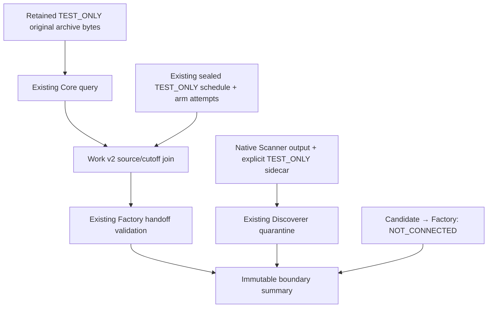

# Current historical research boundaries — v2

Owner dispatched [#205/6623595590](https://github.com/scannercrypto0-gif/super-kumo-v8/issues/205#issuecomment-6623595590)
on 2026-11-04. This is the next delta on existing **Draft #228**. No Antigravity
assignment, no private original-data execution authorization, no merge/activation.
Only Work's namespace and its own scoped CI workflow are changed. Existing v1
fixtures/results remain reproducible at `827f67ff85f26f863536017217cc36503a655eca`.
No broad historical/development suites are repeated by this gate.

## Exact inspected baseline and decisions

| Owner / PR | Exact head consumed | Actual existing contract / call | Gate boundary |
|---|---|---|---|
| Core #226 | `c1104955ae92153221cbe93f26b62cc50bdeb28a` | `aql.core-research.custody-query.v1` → `aql.core-research.custody-query-result.v1`; inner `aql.bridge.custody-range.v1`; `query_custody`, `compatibility_evidence` | Existing TEST_ONLY bridge/library setup and read-only query, raw-source SHA preserved |
| Factory #229 | `6177da84ce67b3dc81ef759521c6b52ffa2132b3` | `aql.factory.research-consumer-seam.v1` → `aql.factory.research-consumer-receipt.v1`; `validate_core_query`, `build_research_handoff` | Actual existing validation/handoff; no evaluator called |
| Scanner #227 | `b9c9ff8602e79c534402f44bce83c56ec2fa6bb9` | `AQL-SCANNER-V1`, `ScannerNominationEnvelope`, `EvidenceReceipt` | Existing typed output and receipt integrity/ID roundtrip; no scan/score |
| Discoverer #230 | `f2006c0e431690ccea8b0532095bf4f2a2dc88ba` | `aql.scanner-adapter.input.v1`, `aql.discoverer.nomination-evidence.v1`; `ScannerQuarantineAdapter.admit`, `assert_eligible_for_research` | Actual quarantine and eligibility refusal; no search/candidates |
| Work #228 parent | `827f67ff85f26f863536017217cc36503a655eca` | Existing `ReceiptStore` / canonical object lineage | Reused create-only storage/replay; no competing custody engine |

Code-file SHA256 closure and every retained TEST_ONLY object raw SHA are frozen
in `fixtures_v2/manifest.json`. It is not assumed any Draft is merged into main.
Workers start with `python -I` and an explicit single component checkout; no
cross-branch module overlay or ambient PYTHONPATH. A runtime audit hook refuses
socket/URL access and child-process creation inside each component worker.
The Work controller only launches these bounded local Python contract workers.

Reviewed Core C1–C4 delivery #180/6605833811, Factory F1–F4 #77/6605990801,
Scanner handoff #134/6605929072 and follow-up #134/6605764375. Scanner handoff
is a request for independent review, **not P0 acceptance**. New pre-handoff
independent Audit #134/6623767670 explicitly confirms **CHANGES_REQUIRED / REAL
CONNECTOR NOT_CONNECTED** at these Scanner/Discoverer pins; this Work delta
does not repair or close their P0 findings. New coordination
#134/6623593991 leaves Claude as sole Scanner/Discoverer writer and requires
continued quarantine. No inaccessible conversation is claimed reviewed.

Upstream CI observations at the refreshed pins: Core focused 41782559313/41782559273
success; Factory focused 41782595896 and Factory matrix 41782596120 success; Scanner
41648583500 success; Discoverer 41671973345 success. These are independently
read run conclusions, not a fresh rerun of their suites. Discoverer broader G1
41671973547 FAILED: actual job126042443277 logs show Windows **Upgrade pip and
setuptools**, `ERROR: To modify pip, please run the following command`, exit1,
before tests; Ubuntu job cancelled, disposable PostgreSQL job passed. This is
not all-green CI and not a demonstrated Discoverer test failure. Its workflow
owner retains that environment defect; Work does not edit G1.

## Proven missing boundaries and this delta

1. Core query returns source version/hash/coverage/bar checksums. Factory requires
an independently supplied **paired schedule**, explicit arm attempts, source
manifest and feature availability. A query cannot create those identities. The
v2 adapter accepts only a retained SHA-sealed existing P2 schedule, joins each
cutoff to the actual Core query, binds prefix checksums and exact source/manifest,
and preserves original attempt/status/NULL slots. It never creates a schedule.
Unknown feature timing blocks that affected Factory boundary rather than filling
it with a cutoff. COMPLETE/PARTIAL/UNKNOWN and confirmed-only refusal are tested.

2. Native Scanner output lacks Discoverer's proposed raw-source/version/timeframe,
full-universe census and independent-verifier fields. The new explicit
`aql.work.scanner-sidecar.v2` supplies those **TEST_ONLY fixture declarations**
with all original attempts/omissions. It is not claimed to be native Scanner
output or an independently verified authentic universe. Original envelope and
receipt bytes are separately retained in hex, parsed/identity checked, and passed
unaltered into Discoverer. Native Scanner UTF-8 semantic digests and raw-byte
SHA256s are different domains; Work does not reserialize an original payload and
call the result its original bytes. Full header/run receipt-ID checks supplement
the upstream payload-only integrity method at this consumer boundary.

3. Core and Factory advanced during implementation. Work refreshed both heads
and reused Core's new `compatibility_evidence` (source/registration/full-cohort
coverage proof) and Factory's `validate_core_query` (native query compatibility),
rather than implementing replacement validators. Their immutable contracts remain
consumer NOT_CONNECTED. Core's full-cohort compatibility evidence can be PARTIAL
while the actual requested feature prefix is COMPLETE; both scopes are preserved.
Factory now has `validate_discoverer` / explicit candidate binding for TEST_ONLY
fixtures. That proposed binding is not an authentic nomination or generated paired
schedule. The real candidate route remains **NOT_CONNECTED** because Scanner P0
is unresolved, there is no eligible candidate here, and no owner-supplied genuine
source/strategy/opportunity/attempt binding. No strategy is generated from
quarantined input and no mapping invents pair IDs or trial decisions.

## Actual gate topology



This proves the connected **contract calls shown**, not an authentic sequential
Scanner→Discoverer→Factory strategy evaluation. Source 15m bars are not converted
into Scanner's 30m features: the feature path is NOT_CONNECTED; Scanner feature
values and scores stay NULL. Factory's fixture feature snapshot is a declared
TEST_ONLY **prefix identity**, not a claim of computed features. Its explicit
clock is test data; no retrospective→PIT promotion follows. No producer is
rebuilt: source envelopes use existing `MarketBar/market_envelope`, retained
schedules were prepared once with existing Core #221 `schedule_pair(test_only=True)`
at `58e423431cc639958736337a65db8a17bfdbaa85`, and Scanner snapshots/receipts use
existing native contract constructors. Preparation source metadata is in the lock.
No Scanner scan, Discoverer generator, Factory `build_lab`, ten-bar model or
private P2 calculation is called by the v2 gate.

The original-byte fixtures are authored synthetic archives, not vendor data.
Core uses its existing fixture bridge/stager and in-memory HistoricalLibrary in
a disposable directory; this is software seam evidence, not production activation
or original-source custody. No private source paths or data are in the package.

## Reproduce the consolidated gate

Provision the four exact public code checkouts above in advance. Python 3.11–3.13
standard library only; no package install. Runtime is offline. One scoped CI gate
runs on those three Python versions and retains only public TEST_ONLY evidence
for seven days. No old v1 or upstream broad suite is dispatched by this workflow.

```sh
python -m tools.research_integration_harness.gate_v2 \
  --checkout core=/approved/offline/core-c110495 \
  --checkout factory=/approved/offline/factory-6177da8 \
  --checkout scanner=/approved/offline/scanner-b9c9ff8 \
  --checkout discoverer=/approved/offline/discoverer-f2006c0 \
  --output /approved/test-only-seam-evidence
```

The gate independently reconciles input slot/universe counts, checks each output
content-addressed filename using a separate stdlib serializer/hash, verifies the
lineage graph, and runs the exact same inputs twice including interrupted staging.
It checks raw source tamper/nonfinality, parent/source/cohort/cutoff drift, late and
unknown feature clocks, missing/duplicate attempts/arms, invalid schema, native
Scanner receipt/header/digest conflicts, missing census, forged witness, NULL→zero,
nomination/authority/PIT promotion, component drift and private-mode refusal.
No output is published until all cohorts pass; original input files are unchanged.
Storage uses the already-delivered create-only ReceiptStore and bounds. V2 also
bounds cohorts4, queries/pairs32, scanner universe64, worker input/output8MiB,
worker timeout30s and one worker at a time. No unlimited spool or new ledger.

Expected census: two symbols; **8 Factory pairs / 16 arm slots**: NO_SIGNAL4,
REJECTED4, UNKNOWN2, UNSCANNED2, NOMINATED2, NULL2, UNRESOLVED0. All16 returns NULL.
Scanner sidecar census contains **8 SYMBOL_PROFILE_ATTEMPT_SLOT units**,
not eight unique assets: nominated1, rejected1, unknown1, failed1, ineligible2,
unscanned2. Each cohort has three distinct symbols, hence six cohort-symbol
members across the two separate cohorts. The native proposed Discoverer counters
map eligible_selected = total slots - ineligible, including unscanned; FAILED
is a subset of native UNKNOWN, with failed_attempts also retained separately.
Both partition equations are independently checked; original disjoint statuses
are retained without double counting. These units are explicit TEST_ONLY mapping
context and are not an authentic verified market universe. Four original attempts reach Discoverer and all four
become **UNKNOWN_DEFERRED**, evidence UNKNOWN_UNVERIFIED / availability UNKNOWN;
**eligible0 / candidates0**. Omitted universe members remain in the denominator.

## Remaining critical blockers and disposition

| Dependency | Current disposition | Required next boundary |
|---|---|---|
| Scanner P0 / source witness / authentic census | UNKNOWN_DEFERRED; source witness NOT_CONNECTED | Claude's coherent repair + independent latest-SHA Audit verdict, not self-declared closure |
| Original private historical execution | NOT_CONNECTED / NOT_PERFORMED | Separate owner authorization and G0-GOV-01 checkpoint; this order does not authorize it |
| Core source → Scanner timeframe/features | NOT_CONNECTED | Owner-supplied versioned original-source/feature adapter and available-at proof; no resampling added here |
| Discoverer candidate → Factory paired schedule | TEST_ONLY owner mapping now exists; authentic route NOT_CONNECTED | Independent P0 closure and explicit genuine source/strategy/opportunity/attempt binding; no invented schedule |
| Upstream broad G1 failure | Windows pip setup defect evidenced | Existing workflow owner repair; targeted success is not all-green |
| Independent acceptance of Work v2 | PENDING | One bounded delta-only Audit after final coherent code/CI delivery |

Evidence-limited verdict: **TEST_ONLY contract boundary implementation and gate**.
Authentic E2E and scientific acceptance are not inferred. No merge/main edits,
G0, holdout, paper/live, private scoring, source acquisition or trading.

## Final local consolidated evidence (public TEST_ONLY)

51/51 focused boundary tests PASS at the final pinned input boundary. Identical
input replay produced identical canonical bytes. GitHub CI at the published Work
HEAD is reported separately in the PR/#205 handoff; this local result alone is
not a GitHub CI claim.

- Manifest raw SHA256: `e14e7c9285507863bcee8856ff65ee1c0ea3736a278c654bd2af18ab439bda84`
- Summary raw/canonical SHA256: `9812f1ecc60c04a9965c02b0f406ad7a1729a7e5c71e529e414207fefa464f4b`
- Gate receipt SHA256: `0b882749253fa42d59c292800bc50b841faab4b6e6c5a482c5708a70ef9762ec`

| Synthetic original-byte source | Raw SHA256 | Historical manifest integrity SHA256 |
|---|---|---|
| TEST_ONLY_V2_BTCUSDT | `ad5402eebe429ad0e78f27114c4dd9376f716de31b099fc71ad1ffb4fc10519f` | `07fa5f28f893eb76704874e7089610710f19cdc14de17576e66430dd2f50731a` |
| TEST_ONLY_V2_ETHUSDT | `44e5cc942fc20f5c76d22f03ef49c01d1c312a000a28ddf9b855987f75ebbaf9` | `07fc6585f13d6186fe5eea8bb796dba23cc369b5b161dfa73f1a1bfbd47e3f2b` |

These hashes identify authored TEST_ONLY archive bytes, not authenticated market
sources. For each cohort, Core's full-source compatibility coverage is
PARTIAL/PARTIAL/PARTIAL/COMPLETE across the four cutoffs; each requested prefix
is COMPLETE. The distinction is retained in the actual output rather than
relabelling the full source as known at every decision.
