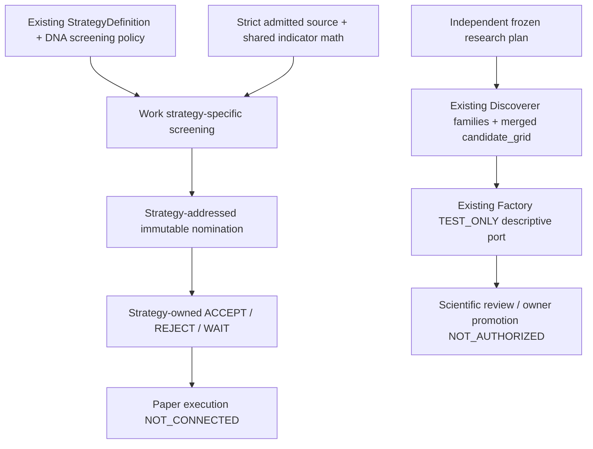

# Strategy-aware screening and independent Discoverer — isolated Work package

Owner dispatch: [#205/6624060886](https://github.com/scannercrypto0-gif/super-kumo-v8/issues/205#issuecomment-6624060886), provisional B, 2026-11-04. G0 remains pending.
Work is sole implementation writer. No Claude/Antigravity assignment, merge,
private-source rerun, sealed holdout, paper/live activation or orders.

## Implemented roles



Scanner selects research-screening candidates addressed to strategy/version/config.
It never makes the strategy decision or an order. Discoverer starts from an
independent hypothesis plan; a real Scanner nomination is not required. Optional
Scanner-origin feedback is always UNKNOWN_DEFERRED under the existing P0 policy.
No fake Scanner nomination is constructed to unlock independent generation.

## Source/contract and ownership inventory

Main was independently refreshed at `dbc191df72f4b4d1ebb7d490926dcad4325dac12`.
Before edits, #227/#230/#228/#226/#229 Draft/open/unmerged heads were refreshed.
The immutable dependency manifest records code-file SHA256s. No Draft is assumed
to be merged into main; pinned workers use `python -I`, no ambient PYTHONPATH.

| Owner/component | Pinned source | Actual code reused | Real connection status |
|---|---|---|---|
| Main strategy contract | `dbc191df72f4b4d1ebb7d490926dcad4325dac12` | `StrategyDefinition.from_dict`, existing AST/registry validation, `candidate_grid`, `AttemptRecorder` | CONNECTED_VERIFIED research contracts only |
| Main policy/DNA | same main | `StrategyDNAV2`, `ScannerProfile`, `_read`, `_test_predicate`, `_channel`, reference digests | CONNECTED_VERIFIED TEST_ONLY policy arithmetic |
| Main indicator registry | same main | `IndicatorRegistryV2` and existing SMA/EMA/RSI/ATR `_compute_values` math kernels | CONNECTED_VERIFIED TEST_ONLY; no authenticated/PIT compute claim |
| Scanner #227 | `b9c9ff8602e79c534402f44bce83c56ec2fa6bb9` | Existing typed `AdmittedBar` / `admit_bars` after strict whole-window Work admission | TEST_ONLY validation; upstream P0 not closed |
| Discoverer #230 | `f2006c0e431690ccea8b0532095bf4f2a2dc88ba` | Existing seven-family registry, stateless template/axes builders; no copied rules/families | CONNECTED_VERIFIED independent TEST_ONLY template generation |
| Factory #229 | `6177da84ce67b3dc81ef759521c6b52ffa2132b3` | `build_research_report` / existing `build_lab` descriptive test fixture | CONNECTED_VERIFIED TEST_ONLY; authentic strategy evaluation NOT_CONNECTED |
| Existing Work #228 | `607e88d69e9450ae66fd5090317c5c296ade8457` | Existing content-addressed create-only ReceiptStore | Reused TEST_ONLY local artifact store; not independent custody |
| Main paper intent | main `src/aql/observation/contracts.py` | `PaperIntent`: proposed/declined/cancelled interface only | Existing interface verified; not an ACCEPT/REJECT/WAIT consumer |
| Main delivery/position contracts | `src/aql/delivery/effects.py`, `observation/positions.py` | Inspected only; offline effects/position records do not establish a strategy consumer | NOT_CONNECTED; no dispatcher activated |
| Approved Paper strategy registry | No approved record/registry found in inspected main/target Drafts | No approval inferred from a research definition or example | NOT_CONNECTED |
| Actual Paper strategy decision consumer | No connected consumer found in inspected main/target Drafts | Executable versioned contract and explicit TEST_ONLY sink provided | PAPER_CONSUMER_NOT_CONNECTED |
| Core #226 | `c1104955ae92153221cbe93f26b62cc50bdeb28a` inspected read-only | No new Core invocation needed for this package | Authentic source/PIT verifier NOT_CONNECTED |

Only NEW `tools/strategy_service_offline/**` and NEW scoped workflow
`.github/workflows/aql-strategy-service-offline.yml` are written in a new isolated
Draft. All files in #227/#230/#228/#226/#229 remain read-only/frozen. This package
does not create a competing Scanner engine, strategy DSL, indicator implementation,
seven-family registry, evaluator, global trial journal or custody service.

## Strategy screening service

`StrategyScreeningSpec.from_existing()` re-parses actual immutable V1 definitions
and linked DNA V2. Preferences are explicit DNA scanner filters/ranking, not a
translation of the V1 entry/exit AST. The spec freezes strategy_id/version,
definition and config digests, preferred indicators/parameters, market/timeframe,
source freshness, deterministic hard gates and optional positive-weight normalized
ranking. Ranking arithmetic reuses `_channel`; its mandatory list must be empty
and threshold zero because ranking is not a strategy decision gate.

The registry snapshot is a **research/test policy catalog**, with no approved
Paper records. The two fixture policies adapt the existing main example using
opposing RSI preferences (>60 vs <40) and opposite ranking directions. Neither
is an owner-approved paper strategy or empirical recommendation.

`scan()` admits each selected symbol once, then caches each distinct indicator
calculation by source SHA/symbol/timeframe/indicator/parameters across strategies.
The fixture computes six feature arrays, not twelve (two symbols × three shared
indicators). No INTRADAY/SWING score is treated as a strategy's decision; the
research_profile_score is NULL and the strategy-specific screening rank is named
separately. Unsupported kernels are CONTRACT_NOT_CONNECTED; no indicators are
reimplemented. TEST_ONLY calls use existing pure kernels after strict byte and
whole-window admission. They never create CONFIRMED bars or bypass CustodyAccessor
to claim authenticated indicator evidence. Real unverified sources are UNKNOWN
and perform zero feature calculations.

Work admission refuses an entire affected symbol window for source tamper,
missing original bytes, wrong source/TF/identity, gap, unordered/duplicate,
missing declared prefix/tail, nonfinality, future/unknown availability, invalid
OHLCV and stale source. It never sorts away or filters corrupt bars then scores
remaining data. Actual original input bytes and frozen source/manifest/universe
SHA are bound to each nomination. Membership must be cutoff-available; unknown
eligibility remains UNKNOWN. A self-reported verifier boolean never admits a
real source. A genuine source-verifier interface remains a critical dependency.

`StrategyNomination` is the versioned canonical payload (`aql.strategy-nomination.v1`)
wrapped in `Frozen`: bytes are the only state, dictionary reads are copies, raw
SHA verified on restore. It retains strategy/version/config, symbol, cutoff,
original source and feature identity, reasons, stable run/attempt and full
per-strategy denominator. Disjoint states are SELECTED/REJECTED/UNKNOWN/UNSCANNED/
INELIGIBLE/FAILED; sum equals every universe member for each strategy. SELECTED
means nominated for strategy review, not accepted trade or approved delivery.

## Strategy decision boundary and replay

`route()` validates nomination schema/seal, strategy/version/config/definition,
feature commitment and no-authority flags, then writes a stable versioned handoff
claim before calling a consumer. No actual Paper consumer is connected; default
result is WAIT / PAPER_CONSUMER_NOT_CONNECTED. Only an explicitly constructed
`TestOnlyStrategySink` can return fixture ACCEPT/REJECT/WAIT, owned by its strategy
policy. ACCEPT uses the existing non-trading PaperIntent `proposed` contract;
REJECT maps to `declined`; WAIT has no intent. None authorizes execution.

Claims/results use a bounded local indexed adapter over #228 ReceiptStore:
create-only content objects, hard-link publication and fsync, readback verification,
conflicting replay rejection, stable config/source/input/policy correlation.
Consumer and router checkpoints are separate; replay returns an existing target
receipt instead of calling the strategy twice. No hostile-filesystem, external
custody, distributed exactly-once or physical power-failure claim is made. A
future real consumer requires independent authorization/transaction semantics.

## Independent Discoverer / Factory lane

`independent_research()` uses the actual #230 family/template and axis builders,
then main's `candidate_grid` for each predeclared draw and `AttemptRecorder` port
for definition validation. It does not call #230 `run_family`, whose admission
currently requires Scanner-shaped evidence. This narrow Work-owned seed/attempt
adapter is the missing independent entrance; no fake nomination or quarantine
bypass is supplied and no family/rule table is copied. The seven existing families
remain the source of truth; the integration fixture uses existing F006 only.

The plan and each draw are immutably claimed **before candidate validation**.
All INVALID/FAILED/DUPLICATE/BUDGET_EXHAUSTED and submitted outcomes remain visible;
no upfront `candidate_grid` failure silently loses attempts. Duplicates retain
original attempt IDs and duplicate_of. A valid definition is re-parsed through
merged StrategyDefinition/IndicatorRegistryV2 and emits a versioned independent
research candidate, evaluation NOT_EVALUATED, promotion NOT_AUTHORIZED. There
are no wall-clock IDs or time-dependent ledger hashes. A failed Factory interface
is recorded FACTORY_HANDOFF_BLOCKED while independent candidate validation survives.

The Factory adapter re-parses the real definition and labels the existing retained
Factory synthetic fixture with its digest before invoking the existing descriptive
port. This demonstrates executable family → valid StrategyDefinition → Factory
contract handoff. It **does not** evaluate the candidate's rule triggers or prove
that fixture opportunities arose from that strategy. No new backtester is added.
Output explicitly distinguishes descriptive fixture evaluation from authentic
strategy-semantic historical evaluation (NOT_CONNECTED). Scientific review and
owner-controlled promotion remain separate. Optional Scanner feedback only adds
a quarantined source commitment and cannot become mandatory for research.

## Run / evidence

Python3.11–3.13 standard library. Provision exact public code checkouts from the
matrix before running; component runtime network/child-process calls are denied.
The source/math/test data are synthetic; no private data or exchange is accessed.

```sh
python -m tools.strategy_service_offline.gate \
  --checkout main=. \
  --checkout work=/approved/offline/work-607e88d \
  --checkout scanner=/approved/offline/scanner-b9c9ff8 \
  --checkout discoverer=/approved/offline/discoverer-f2006c0 \
  --checkout factory=/approved/offline/factory-6177da8 \
  --output /approved/strategy-test-only-evidence
```

For only the executable completed package, replace `.gate` with the package name
`tools.strategy_service_offline`, keeping the same arguments. No broad upstream
or private P0/P1/P2 suites are rerun by this scoped workflow. Exact final SHA, per-job
CI logs, immutable result/gate hashes and artifact retention are posted to #205.
The fixture/dependency manifests freeze all bytes and source lineage in git.

Expected integration: each of two strategies sees five symbols; one SELECTED,
one REJECTED, one UNKNOWN/missing, one UNSCANNED/budget, one INELIGIBLE. They
nominate different symbols AAA vs BBB despite shared source and shared math.
Research independently validates four F006 parameter draws and routes them to
existing Factory descriptive fixture receipts. Test-only strategy decisions
include ACCEPT/WAIT, with REJECT separately tested; all actual Paper/live statuses
remain NOT_ACTIVATED. Independent whole-package counts/hashes/restart and targeted
source, routing, seal, attempts/budget/duplicate negative tests are in one gate.

Bounds:16 strategies,256 universe symbols,8192 source bars,512 planned draws,
256 allowed candidate draws,32 values/axis,7 existing families, worker8MiB/30s,
journal2048 indexes and existing store4096 objects/8MiB per object. No unbounded
spool, optimizer or background service; no credentials or operational dispatcher.

## Remaining blockers / exact upstream changes

See [UPSTREAM_BOUNDARIES.md](UPSTREAM_BOUNDARIES.md) for precise frozen-owner paths,
what Work's boundary now protects, and what cannot be closed without owner action.
The result is executable TEST_ONLY engineering evidence, not Paper readiness,
real connected market screening, independent scientific acceptance or G0 approval.
